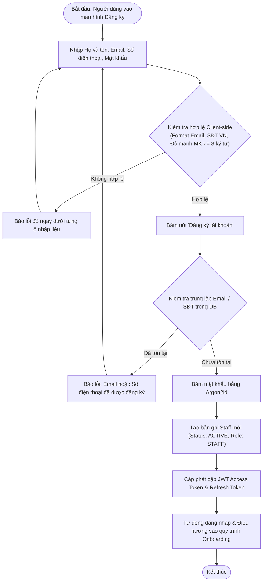
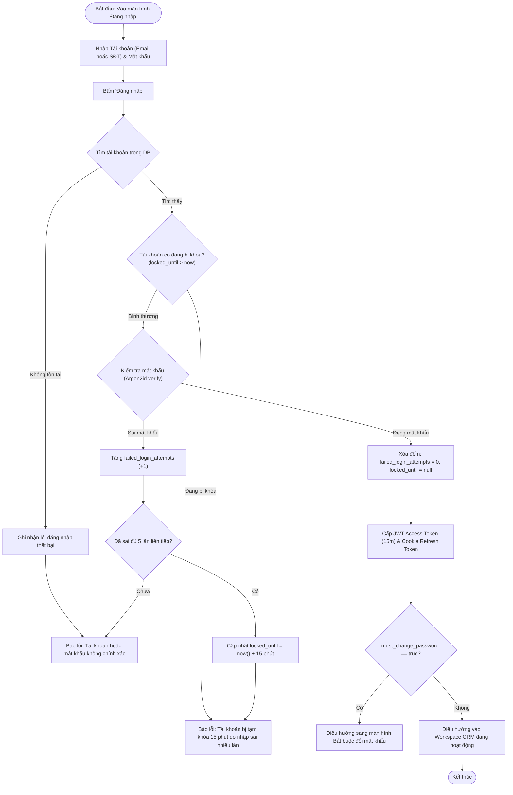
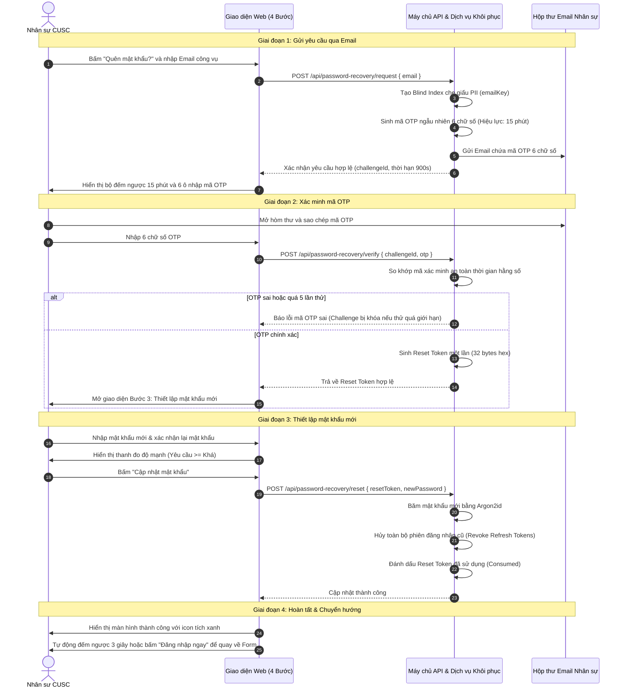
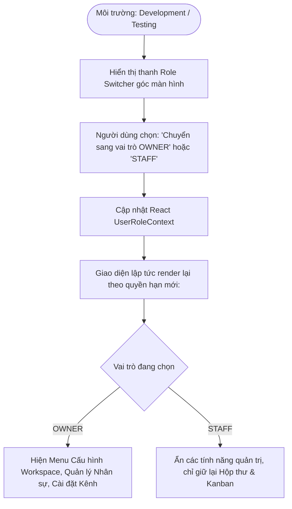

# TÀI LIỆU CHUẨN HÓA LUỒNG NGHIỆP VỤ XÁC THỰC, PHÂN QUYỀN & QUẢN TRỊ TÀI KHOẢN (AUTH & IAM WORKFLOWS)

> **Mã tài liệu:** `SPEC-CRM-AUTH-01`  
> **Phiên bản:** `1.0.0`  
> **Trạng thái:** `Đã chuẩn hóa (Standardized & Production Ready)`  
> **Áp dụng cho:** Hệ thống CUSC Social Recruitment & Admissions CRM  

---

## 1. TỔNG QUAN HỆ THỐNG & MỤC TIÊU NGHIỆP VỤ

### 1.1. Bối cảnh
Trong hệ thống tuyển sinh và chăm sóc ứng viên đa kênh **CUSC Recruitment CRM**, module **Auth & IAM** đóng vai trò là "cánh cổng bảo mật đầu tiên" (First Line of Defense). Hệ thống xử lý thông tin định danh của các cán bộ quản lý tuyển sinh, chuyên viên tư vấn và dữ liệu học viên tiềm năng (Leads). Do đó, việc chuẩn hóa luồng nghiệp vụ xác thực người dùng, phân cấp quyền hạn và khôi phục tài khoản đòi hỏi tính bảo mật, tiện dụng và tuân thủ các chuẩn an toàn thông tin khắt khe.

### 1.2. Mục tiêu Nghiệp vụ Cốt lõi
1. **Trải nghiệm Đăng nhập Đa dạng & Thuận tiện**: Cho phép nhân sự linh hoạt đăng nhập bằng **Email công vụ** hoặc **Số điện thoại cá nhân**, giảm thiểu sự phụ thuộc vào một phương thức duy nhất.
2. **Bảo vệ Tài khoản Chống Tấn công Dò quét (Anti Brute-force)**: Tự động phát hiện các hành vi nhập sai mật khẩu liên tiếp và áp dụng cơ chế khóa tạm thời có thời hạn, bảo vệ an toàn cho cơ sở dữ liệu.
3. **Phân quyền Minh bạch (Strict RBAC)**: Định rõ giới hạn tác vụ giữa **OWNER** (Chủ sở hữu hệ thống/Giám đốc tuyển sinh) và **STAFF** (Chuyên viên tư vấn), tránh rò rỉ dữ liệu hoặc can thiệp cấu hình trái phép giữa các bộ phận.
4. **Khôi phục Tài khoản Tự phục vụ 100% (Zero-Helpdesk Password Recovery)**: Người dùng có thể tự khôi phục mật khẩu qua Email OTP chỉ trong vòng 60 giây mà không cần nhờ đến sự hỗ trợ thủ công từ quản trị viên hệ thống.

---

## 2. MA TRẬN PHÂN QUYỀN TRUY CẬP (RBAC PERMISSION MATRIX)

Hệ thống phân cấp 2 vai trò chuẩn hóa chính trong mô hình vận hành:

| Nghiệp vụ / Tính năng | OWNER (Chủ sở hữu / Quản trị viên) | STAFF (Chuyên viên Tư vấn) | Ghi chú Nghiệp vụ |
| :--- | :---: | :---: | :--- |
| **Đăng nhập & Quản lý Thông tin Cá nhân** | Toàn quyền | Toàn quyền | Tự cập nhật tên, số điện thoại, đổi mật khẩu cá nhân |
| **Khởi tạo & Cấu hình Workspace Tuyển sinh** | Toàn quyền | Không có quyền | Chỉ OWNER được tạo Workspace mới và đổi thông tin tổ chức |
| **Quản lý Thành viên (Thêm/Sửa/Khóa Staff)** | Toàn quyền | Không có quyền | OWNER phân bổ nhân viên vào các chi nhánh/đơn vị |
| **Kết nối Kênh Mạng xã hội (Fanpage/Zalo/TikTok)** | Toàn quyền | Không có quyền | Cần cấp phép quyền quản trị ứng dụng và mã kết nối |
| **Cấu hình Webhook & Hệ thống Tích hợp** | Toàn quyền | Không có quyền | Bảo mật các Secret Key và URL Callback |
| **Tiếp nhận & Xử lý Hội thoại (Unified Inbox)** | Toàn quyền | Toàn quyền | Tư vấn viên chat trực tiếp với học viên/phụ huynh |
| **Quản lý Hồ sơ Ứng viên (Admission Kanban)** | Toàn quyền | Toàn quyền (Phạm vi chỉ định) | Kéo thả giai đoạn hồ sơ, gọi điện tư vấn |
| **Xem Báo cáo Tổng thể Hệ thống** | Toàn hệ thống | Phạm vi cá nhân / Nhóm | OWNER xem hiệu suất toàn bộ nhân sự |
| **Chuyển đổi Vai trò Thử nghiệm (Role Switcher)** | Bật/Tắt trên UI Dev | Bật/Tắt trên UI Dev | Chỉ hiển thị trên môi trường phát triển/thử nghiệm |

---

## 3. CÁC QUY TRÌNH NGHIỆP VỤ CHI TIẾT (BUSINESS WORKFLOWS)

### 3.1. WF-AUTH-01: Quy trình Đăng ký Tài khoản Mới (Sign Up)

Quy trình áp dụng khi một người dùng mới tự đăng ký tài khoản tham gia hệ thống.

**Các quy tắc nghiệp vụ áp dụng:**
- **BR-AUTH-01 (Mật khẩu chuẩn)**: Mật khẩu phải có độ dài tối thiểu 8 ký tự, bao gồm ít nhất 1 chữ thường, 1 chữ số. Khuyến nghị thêm chữ hoa và ký tự đặc biệt (hiển thị trực quan qua thước đo độ mạnh).
- **BR-AUTH-02 (Chuẩn hóa số điện thoại)**: Các đầu số hợp lệ tại Việt Nam: `03`, `05`, `07`, `08`, `09`, gồm đúng 10 chữ số. Hệ thống tự động loại bỏ khoảng trắng hoặc ký tự phân tách thừa.

---

### 3.2. WF-AUTH-02: Quy trình Đăng nhập Hệ thống (Sign In)

Quy trình xử lý xác thực phiên làm việc hàng ngày của nhân sự.

**Các quy tắc nghiệp vụ áp dụng:**
- **BR-AUTH-03 (Chống Brute-force)**: Sau 5 lần nhập sai mật khẩu liên tiếp, tài khoản bị tạm khóa 15 phút. Trong thời gian này, dù nhập đúng mật khẩu hệ thống vẫn từ chối cho đến khi hết thời gian khóa.
- **BR-AUTH-04 (Xóa bộ đếm khi đăng nhập đúng)**: Khi người dùng đăng nhập thành công, số lần đăng nhập sai trước đó lập tức được reset về 0.

---

### 3.3. WF-AUTH-03: Quy trình Quên Mật khẩu & Khôi phục Tự phục vụ (Password Recovery)

Quy trình 4 bước khép kín giúp người dùng lấy lại quyền truy cập qua Email OTP:

**Các quy tắc nghiệp vụ áp dụng:**
- **BR-AUTH-05 (Thời hạn OTP)**: Mã OTP có hiệu lực tối đa 15 phút kể từ lúc gửi. Sau 15 phút, mã tự động vô hiệu hóa.
- **BR-AUTH-06 (Giới hạn thử lại OTP)**: Một mã OTP chỉ được phép nhập sai tối đa 5 lần. Quá 5 lần, phiên khôi phục bị hủy bỏ ngay lập tức để ngăn chặn dò mã tự động.
- **BR-AUTH-07 (Thu hồi phiên cũ)**: Ngay sau khi đổi mật khẩu thành công, toàn bộ các phiên làm việc đang duy trì trên các thiết bị khác (máy tính cơ quan, điện thoại) bị đăng xuất bắt buộc nhằm bảo đảm an toàn.

---

### 3.4. WF-AUTH-04: Quy trình Chuyển đổi Vai trò Thử nghiệm (Role Switcher)

Để hỗ trợ đội ngũ kiểm thử (QA/QC) và nhà phát triển (Developers) kiểm tra giao diện và luồng nghiệp vụ giữa 2 vai trò mà không cần đăng xuất đăng nhập liên tục:

---

## 4. XỬ LÝ CÁC TRƯỜNG HỢP NGOẠI LỆ & BIÊN (EDGE CASES)

| Tình huống ngoại lệ | Phản ứng của Hệ thống | Trải nghiệm phía Người dùng |
| :--- | :--- | :--- |
| **Mạng chập chờn khi gửi OTP** | Dịch vụ gửi email xếp hàng đợi tự động thử lại (Retry 3 lần) qua cơ chế hàng đợi. | Nút "Gửi lại mã" trên UI bị khóa tạm thời trong 60 giây để tránh spam. |
| **Người dùng mở 2 tab đổi mật khẩu** | Chỉ tab nào gửi yêu cầu xác thực OTP cuối cùng được cấp Reset Token mới nhất. Bản ghi cũ bị chuyển trạng thái `SUPERSEDED`. | Tab cũ hiển thị thông báo "Yêu cầu đã hết hạn, vui lòng sử dụng mã mới nhất". |
| **Token hết hạn giữa phiên làm việc** | `api-client` nhận mã HTTP 401, tự động kích hoạt request `/api/auth/refresh` bằng cookie ngầm để lấy Access Token mới. | Trải nghiệm làm việc của người dùng diễn ra liên tục, không bị ngắt quãng hay văng khỏi trang. |
| **Phát hiện Token Refresh bị đánh cắp** | Khi một Refresh Token cũ đã bị thu hồi mà vẫn có request gửi lên, hệ thống kích hoạt báo động **Token Family Invalidation**. | Toàn bộ các phiên đang hoạt động của tài khoản đó bị thu hồi ngay lập tức, bắt buộc đăng nhập lại từ đầu. |

---

## 5. TIÊU CHUẨN NGHIỆP VỤ & ĐỊNH NGHĨA HOÀN THÀNH (DOD)

Một tính năng hoặc bản cập nhật thuộc module Auth được xem là đạt chuẩn triển khai khi thỏa mãn:
1. **Kiểm thử Tự động (Automated Tests)**:
   - Toàn bộ Unit Tests và Integration Tests của `AuthService`, `JwtTokenService`, `PasswordRecoveryService` chạy qua 100% không có lỗi.
   - Kiểm thử bảo mật Argon2id và timingSafeEqual chạy đúng logic.
2. **Tuân thủ Chuẩn Accessibility (a11y)**:
   - Màn hình Đăng nhập / Đăng ký đạt **100/100 điểm Lighthouse Accessibility**.
   - Điều hướng bàn phím đầy đủ (`Tab`, `Enter`, `ArrowLeft`, `ArrowRight`), nhãn `aria-label`, `role="tab"` rõ ràng.
3. **Hiệu năng Tải trang (Performance)**:
   - Initial JS chunk < 100 KB gzip, First Contentful Paint < 1.5s trên môi trường Production.
