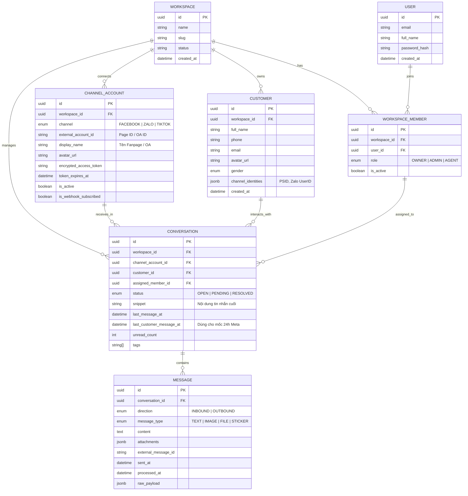
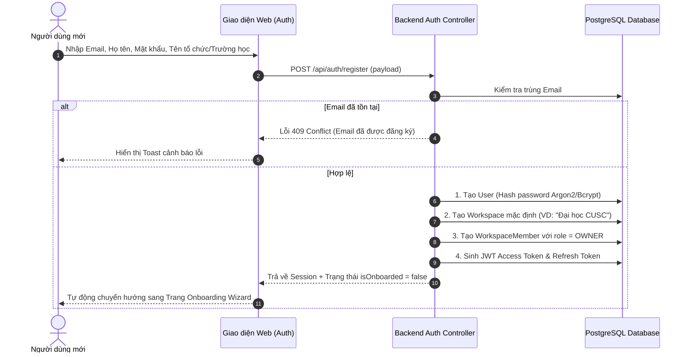
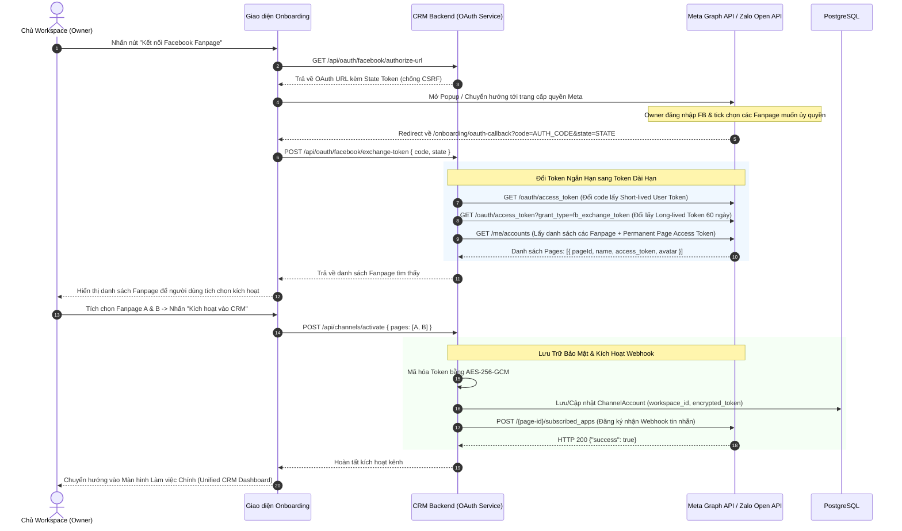
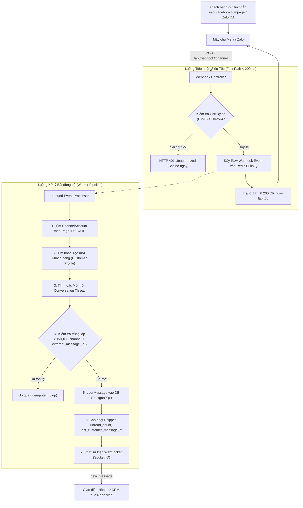
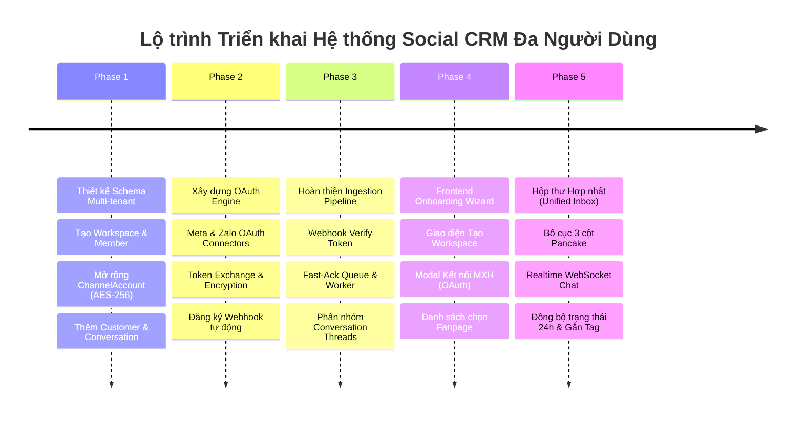

# TÀI LIỆU CHUẨN HÓA LUỒNG NGHIỆP VỤ HỆ THỐNG SOCIAL CRM ĐA NGƯỜI DÙNG (PANCAKE-STYLE)

> **Mã tài liệu:** `SPEC-CRM-01`  
> **Phiên bản:** `1.0.0`  
> **Trạng thái:** `Đã chuẩn hóa (Draft for Implementation)`  
> **Áp dụng cho:** Hệ thống CUSC Social Recruitment & Admissions CRM  

---

## 1. TỔNG QUAN HỆ THỐNG & MỤC TIÊU NGHIỆP VỤ

### 1.1. Bối cảnh & Định hướng
Hệ thống được phát triển theo mô hình **Đa tổ chức (Multi-Tenant Social CRM & Omnichannel Inbox)** tương tự các nền tảng hàng đầu thị trường như **Pancake.vn**, **Haravan**, hoặc **Sapo Social**.

Hệ thống đóng vai trò làm trung tâm điều phối giao tiếp (Single Source of Truth) giữa các doanh nghiệp/tổ chức giáo dục và khách hàng/ứng viên tiềm năng đến từ các nền tảng mạng xã hội: **Facebook Fanpage / Messenger**, **Zalo Official Account (OA)**, **TikTok Shop / Messaging**, và các luồng nhập liệu thủ công (Manual / CSV / Spreadsheet).

### 1.2. Mục tiêu Nghiệp vụ Cốt lõi
1. **Đa tổ chức độc lập (Strict Multi-Tenancy):** Mỗi khách hàng doanh nghiệp sở hữu một **Workspace** riêng biệt, bảo vệ toàn vẹn và phân lập dữ liệu (Data Isolation) tuyệt đối giữa các tổ chức.
2. **Quy trình Nhập môn Tự động (Self-service Onboarding):** Người dùng đăng ký tài khoản được dẫn dắt qua giao diện Onboarding trực quan để kết nối tài khoản mạng xã hội thông qua giao thức chuẩn **OAuth 2.0**.
3. **Thu thập Tin nhắn Tập trung (Centralized Ingestion):** Tự động nhận diện, định danh khách hàng, gom các tin nhắn từ nhiều Fanpage/Zalo OA về một cơ sở dữ liệu duy nhất theo mô hình Hội thoại (Conversation Threads).
4. **Hộp thư Trực tiếp Hợp nhất (Unified Live Inbox):** Cho phép đội ngũ tư vấn viên/tuyển sinh cùng làm việc, tiếp nhận cuộc hội thoại (Claim/Assign), phản hồi tin nhắn trực tiếp từ CRM mà không cần mở song song nhiều tab Facebook/Zalo.
5. **Tự động hóa & Phân loại Khách hàng (Lead Intelligence):** Tự động bóc tách số điện thoại, email, phân loại nhu cầu qua AI/Rule-based engine và đẩy vào phễu chăm sóc.

---

## 2. MÔ HÌNH THỰC THỂ DỮ LIỆU ĐA TỔ CHỨC (MULTI-TENANT DOMAIN MODEL)

Để chuyển đổi từ kiến trúc đơn lẻ sang mô hình Pancake, hệ thống chuẩn hóa cấu trúc dữ liệu theo sơ đồ sau:

---

## 3. CHUẨN HÓA CÁC LUỒNG NGHIỆP VỤ CHI TIẾT

### 3.1. LUỒNG 1: Đăng ký Tài khoản & Khởi tạo Không gian làm việc (Registration & Tenant Creation)

---

### 3.2. LUỒNG 2: Giao diện Onboarding & Kết nối Kênh MXH qua OAuth (Onboarding Wizard & OAuth Dance)

Giao diện Onboarding hướng dẫn người dùng kết nối Fanpage/Zalo OA theo tiêu chuẩn **OAuth 2.0**:

---

### 3.3. LUỒNG 3: Thu thập Tin nhắn Khách hàng Tập trung (Realtime Ingestion & Aggregation)

Khi khách hàng/học viên nhắn tin vào Fanpage hoặc Zalo OA, luồng tiếp nhận xử lý theo chuẩn **Fast Acknowledgment + Event-Driven Architecture**:

---

### 3.4. LUỒNG 4: Hộp thư Hợp nhất & Phản hồi Khách hàng (Pancake-style Unified Inbox)

```mermaid
sequenceDiagram
    autonumber
    actor Agent as Nhân viên Tư vấn
    participant Web as Giao diện Unified Inbox
    participant API as CRM Backend
    participant Meta as Meta Graph API / Zalo Open API
    actor Cust as Khách hàng / Ứng viên

    Note over Web: WebSocket nhận tin nhắn mới -> Bật thông báo & badge chưa đọc
    Agent->>Web: Nhấp chọn cuộc hội thoại trong Danh sách (Conversation List)
    Web->>API: PATCH /api/conversations/:id/assign (Tiếp nhận hội thoại)
    API-->>Web: Cập nhật assigned_member_id
    Web->>API: POST /api/conversations/:id/read (Đánh dấu đã đọc)

    Agent->>Web: Soạn tin nhắn trả lời và ấn Gửi
    Web->>Web: Kiểm tra quy tắc cửa sổ 24 giờ của Meta
    alt Quá 24 giờ từ tin nhắn cuối của khách
        Web-->>Agent: Cảnh báo: "Đã quá 24h. Chỉ gửi được tin nếu chọn Message Tag hợp lệ."
    else Trong khung 24 giờ
        Web->>API: POST /api/conversations/:id/messages (Gửi tin outbound)
        API->>API: Giải mã AES-256 Page Access Token
        API->>Meta: POST /v19.0/me/messages (Gửi tin qua Meta Graph API)
        Meta-->>Cust: Khách hàng nhận được tin nhắn trên Messenger / Zalo
        Meta-->>API: Trả về external_message_id
        API->>API: Lưu Message (direction = OUTBOUND) vào DB
        API-->>Web: Xác nhận gửi thành công
        Web-->>Agent: Hiển thị bong bóng chat gửi thành công (dấu tick xanh)
    end
```

---

## 4. MA TRẬN ĐỐI CHIẾU KHOẢNG CÁCH (GAP ANALYSIS)

| Hạng mục | Hiện trạng Hệ thống (`Current`) | Yêu cầu Mục tiêu Chuẩn Pancake (`Target`) | Nhiệm vụ Cần chỉnh sửa |
| :--- | :--- | :--- | :--- |
| **Mô hình Dữ liệu** | Chỉ có `Staff`, `ChannelAccount`, `Message`. Không có `Workspace`. | Multi-tenant hoàn chỉnh: `Workspace`, `WorkspaceMember`, `Customer`, `Conversation`, `Message`. | Viết migration bổ sung `Workspace`, đổi cấu trúc các bảng con mang `workspace_id`. |
| **Quản lý Kênh MXH** | `ChannelAccount` lưu tĩnh không có token bảo mật. | `ChannelAccount` lưu `encrypted_access_token`, `token_expires_at`, `refresh_token`. | Bổ sung cơ chế mã hóa AES-256-GCM khi ghi và giải mã khi đọc token. |
| **Xác thực Webhook** | Chỉ có endpoint POST thô, chưa có xác thực Token Challenge của Meta. | Hỗ trợ cả `GET` (Meta Verify Token) và `POST` (HMAC SHA-256 Signature). | Bổ sung `GET /api/webhook/:channel` trả `hub.challenge` và Middleware kiểm tra `X-Hub-Signature-256`. |
| **Cơ chế Hội thoại** | Tin nhắn lưu phẳng dạng log, không có Thread. | Quản lý theo `Conversation` (chưa đọc, người phụ trách, nhãn phân loại, mốc thời gian 24h). | Tách logic message thành Conversation-based Ingestion. |
| **Quy trình Onboarding** | Người dùng vào thẳng trang Import CSV/Spreadsheet. | Wizard 3 bước: Thông tin Workspace $\rightarrow$ Đăng nhập OAuth chọn Page $\rightarrow$ Mời nhân viên. | Xây dựng Module Onboarding Wizard trên Frontend và API OAuth Controller trên Backend. |
| **Giao diện Chat** | Chưa có giao diện Live Chat. | Giao diện Hộp thư 3 cột (Danh sách chat, Cửa sổ nhắn tin, Thông tin hồ sơ khách hàng). | Xây dựng Module `UnifiedInbox` tích hợp WebSocket client. |

---

## 5. NHỮNG ĐIỂM KỸ THUẬT QUAN TRỌNG & RỦI RO SỐNG CÒN

> [!IMPORTANT]
> ### 1. Chính sách Xét duyệt Ứng dụng (Meta App Review & Zalo OA Verification)
> - **Meta:** Để ứng dụng hoạt động với người dùng thực tế (ngoài tài khoản Developer/Tester), hệ thống bắt buộc phải:
>   1. Hoàn tất **Xác minh Doanh nghiệp (Business Verification)** trong Meta Business Manager.
>   2. Vượt qua **App Review** cho các quyền: `pages_messaging`, `pages_manage_metadata`, `pages_show_list`, `pages_read_engagement`.
>   3. Cung cấp video demo mô tả đúng luồng sử dụng và chính sách bảo mật (Privacy Policy URL).
> - **Zalo OA:** Cần đăng ký ứng dụng trên Zalo for Developers và liên kết với tài khoản Zalo OA đã xác thực Doanh nghiệp (tick vàng) để được cấp quyền gọi API nhắn tin.

> [!WARNING]
> ### 2. Quy tắc Cửa sổ Tin nhắn 24 Giờ của Meta (Meta 24-Hour Messaging Policy)
> - Trang Fanpage chỉ được phép phản hồi miễn phí tin nhắn cho khách hàng trong vòng **24 giờ** tính từ thời điểm tin nhắn cuối cùng của khách hàng (`last_customer_message_at`).
> - Sau 24 giờ, mọi nỗ lực gửi tin dạng `STANDARD_MESSAGING` sẽ bị Meta trả về lỗi `HTTP 400 (#10) Message cannot be sent outside the 24-hour window`.
> - **Giải pháp:** Hệ thống CRM cần lưu vết chính xác `last_customer_message_at`. Khi hết hạn, giao diện Web phải vô hiệu hóa khung nhập văn bản tự do và chỉ cho phép gửi các mẫu tin nhắn kèm **Message Tags** được phép (`CONFIRMED_EVENT_UPDATE`, `POST_PURCHASE_UPDATE`, `ACCOUNT_UPDATE`) hoặc chuyển sang gửi thông báo qua Zalo ZNS / SMS Brandname.

> [!CAUTION]
> ### 3. Bảo mật Tuyệt đối Access Token (Token Security at Rest)
> - **Rủi ro:** Token của Fanpage cho phép đọc toàn bộ tin nhắn riêng tư và đăng bài mạo danh Fanpage của khách hàng.
> - **Giải pháp:**
>   - Không bao giờ lưu token thô (plaintext) trong database hoặc in ra log.
>   - Dùng khóa mã hóa cấp độ ứng dụng `AES-256-GCM` (`APP_ENCRYPTION_KEY` lưu trong biến môi trường bí mật).
>   - Xây dựng cơ chế phát hiện token bị hủy quyền (ví dụ khi Admin đổi mật khẩu Facebook) để cập nhật trạng thái `is_active = false` và gửi cảnh báo Toast cho người dùng kết nối lại.

> [!TIP]
> ### 4. Chống trùng lặp & Khả năng Chịu tải Webhook (Fast-Ack & Idempotency)
> - Máy chủ Webhook của Meta có cơ chế tự động thử lại (Retry) nếu CRM phản hồi chậm hơn **3000ms**.
> - **Quy tắc vàng:** Không thực hiện bất kỳ truy vấn nặng, gọi AI phân loại hay lưu trữ phức tạp nào trong request HTTP của Webhook. Chỉ kiểm tra chữ ký HMAC $\rightarrow$ Đẩy vào Queue $\rightarrow$ Trả `HTTP 200 OK` trong vòng **< 200ms**.
> - Ràng buộc `UNIQUE(channel, external_message_id)` trong DB đảm bảo dù Webhook bị bắn lặp 10 lần thì hệ thống vẫn duy trì tính bất biến (Idempotent), không sinh ra tin nhắn trùng.

---

## 6. LỘ TRÌNH THỰC HIỆN ĐỀ XUẤT (STEP-BY-STEP ROADMAP)

---

## 7. KẾT LUẬN & ĐỀ XUẤT BƯỚC TIẾP THEO

Tài liệu này đóng vai trò là kim chỉ nam đặc tả nghiệp vụ cho toàn bộ quá trình phát triển tính năng Social CRM. Để duy trì tính liên tục và không phá vỡ 33 bài test tự động hiện có của hệ thống:

* **Bước tiếp theo ưu tiên:** Cập nhật file Prisma Schema (`workspace.prisma`, `messaging.prisma`, `user.prisma`) để thiết lập mô hình quan hệ đa người dùng, sau đó chạy migration an toàn trong môi trường phát triển.
