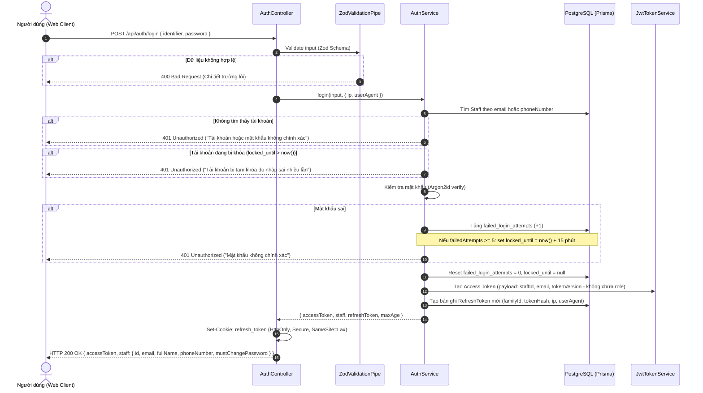
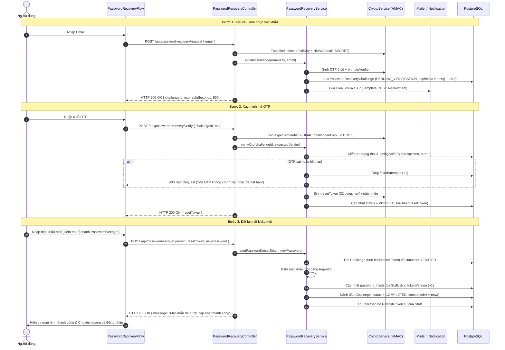
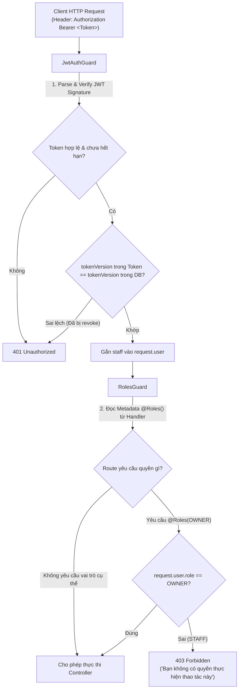

# Tài liệu Kỹ thuật và Kiến trúc Module Xác thực & Phân quyền (Auth & IAM)

Module **Auth & IAM (Identity and Access Management)** chịu trách nhiệm định danh người dùng, xác thực đăng nhập, cấp phát và thu hồi phiên truy cập (JWT & Refresh Token Rotation), kiểm soát phân quyền dựa trên vai trò (Role-Based Access Control - RBAC: `OWNER` và `STAFF`), và quản lý toàn bộ vòng đời khôi phục mật khẩu tự phục vụ qua Email OTP an toàn cao cho hệ thống **CUSC Recruitment CRM**.

---

## 1. Mục tiêu & Nguyên tắc Thiết kế

### 1.1. Mục tiêu Kỹ thuật & Nghiệp vụ
- **Xác thực Đa hình thức (Flexible Identifier)**: Hỗ trợ người dùng đăng nhập linh hoạt bằng địa chỉ **Email** hoặc **Số điện thoại** Việt Nam (chuẩn hóa đầu số `0x` hoặc `+84`).
- **Bảo mật Chuẩn Ngân hàng**: Băm mật khẩu bằng thuật toán **Argon2id** (chuẩn OWASP khuyến nghị), chống tấn công GPU/ASIC và thay thế hoàn toàn MD5/SHA thô sơ.
- **Quản lý Phiên Không trạng thái & Chống Đánh cắp Token (Stateful Token Rotation)**: Access Token tồn tại ngắn hạn (15 phút), Refresh Token lưu trong cookie `HttpOnly` với cơ chế **Token Family & Rotation** giúp tự động thu hồi toàn bộ phiên nếu phát hiện token bị dùng lại (token replay attack).
- **Phân quyền Động theo Không gian làm việc (Workspace-Scoped RBAC)**: Phân tách rõ rệt quyền hạn giữa **OWNER** (Chủ sở hữu Workspace) và **STAFF** (Chuyên viên tư vấn theo Workspace) thông qua bảng `workspace_members`. Bảng `staff` thuần túy lưu trữ định danh tài khoản, không chứa role toàn cục; API Auth không trả về role cố định, role được Context Workspace phía Frontend truy vấn và áp dụng động.
- **Khôi phục Mật khẩu Tự phục vụ An toàn Tuyệt đối**: Cơ chế Blind Index (HMAC-SHA256) che giấu thông tin định danh cá nhân (PII), OTP 6 chữ số ngẫu nhiên mật mã học, mã hóa xác minh chống rò rỉ dữ liệu và chống Brute-force nhiều lớp.

### 1.2. Nguyên tắc Kiến trúc (Clean Architecture / DDD)
Hệ thống tuân thủ nghiêm ngặt mô hình kiến trúc đa lớp độc lập:

```
┌────────────────────────────────────────────────────────────────────────┐
│                   Presentation Layer (Web & API)                       │
│  - AuthController (/api/auth/login, /api/auth/register, /api/auth/me)   │
│  - PasswordRecoveryController (/api/password-recovery/*)               │
│  - OwnerController (/api/owner/*)                                      │
│  - React Frontend: AuthPage, LoginForm, SignUpForm, RecoveryFlow      │
└───────────────────────────────────┬────────────────────────────────────┘
                                    │
┌───────────────────────────────────▼────────────────────────────────────┐
│                       Application Layer                                │
│  - AuthService (Xác thực đăng nhập, đăng ký, khóa tài khoản)           │
│  - PasswordRecoveryInitiationService & VerificationService             │
│  - PasswordRecoveryResetService (Xác thực Reset Token, đổi mật khẩu)   │
└───────────────────────────────────┬────────────────────────────────────┘
                                    │
┌───────────────────────────────────▼────────────────────────────────────┐
│                    Domain & Contracts Layer                            │
│  - WorkspaceMemberRole (OWNER, STAFF), StaffStatus (ACTIVE, LOCKED)    │
│  - PasswordRecoveryChallengeStatus, PasswordRecoveryDeliveryStatus     │
│  - Zod Contracts & DTOs (loginRequestSchema, registerRequestSchema)    │
└───────────────────────────────────┬────────────────────────────────────┘
                                    │
┌───────────────────────────────────▼────────────────────────────────────┐
│                     Infrastructure & Platform                          │
│  - PostgreSQL + Prisma ORM (Staff, RefreshToken, RecoveryChallenge)   │
│  - Argon2id & Crypto Service (HMAC-SHA256 Blind Indexing, Safe Compare)│
│  - JwtTokenService (Khóa ký asymmetric/symmetric, Claims Payload)      │
│  - Fastify HttpAdapter Cookie Engine (HttpOnly, SameSite=Lax)          │
└────────────────────────────────────────────────────────────────────────┘
```

---

## 2. Tiêu chuẩn Kỹ thuật & Bảng Yêu cầu (Technical Requirements)

| Mã YC | Hạng mục | Chi tiết Kỹ thuật | Tiêu chuẩn Chấp thuận (DoD) |
| :--- | :--- | :--- | :--- |
| **SEC-01** | **Password Hashing** | Sử dụng thuật toán Argon2id với tham số an toàn cao (memoryCost 65536 KB, timeCost 3). | Mật khẩu lưu trong cột `password_hash` luôn có tiền tố `$argon2id$`. Hỗ trợ migration từ bcrypt cũ. |
| **SEC-02** | **Multi-identifier Login** | Cho phép đăng nhập qua Email (chuẩn hóa RFC 5322 lowercase) hoặc Số điện thoại (9-11 số, định dạng VN). | Tìm kiếm linh hoạt trong DB; nếu là số điện thoại tự động chuẩn hóa về dạng quốc gia. |
| **SEC-03** | **Anti Brute-force Lockout** | Theo dõi số lần đăng nhập thất bại liên tiếp (`failed_login_attempts`). | Đạt 5 lần sai -> Khóa tài khoản tạm thời 15 phút (`locked_until = now() + 15m`). Trả về HTTP 401 với thông điệp rõ ràng. |
| **SEC-04** | **Refresh Token Rotation** | Cấp phát cặp `(accessToken, refreshToken)`. Refresh token được gắn `family_id` và lưu dạng SHA-256 hash. | Mỗi lần refresh: Token cũ bị thu hồi (`revoked_at`), cấp token mới. Nếu token cũ bị dùng lại -> Hủy toàn bộ family. |
| **SEC-05** | **Blind Indexing Recovery** | Không lưu email dạng raw trong bảng khôi phục mật khẩu. Dùng `emailKey = HMAC_SHA256(normalizedEmail, SECRET)`. | Bảng `password_recovery_challenges` không chứa PII dạng plaintext, ngăn ngừa triệt để rò rỉ dữ liệu khi dump DB. |
| **SEC-06** | **OTP Crypto Verification** | OTP gồm 6 chữ số sinh từ `crypto.randomInt()`. Băm xác minh bằng `otpVerifier = HMAC_SHA256(challengeId:otp, OTP_SECRET)`. | Xác minh thời gian hằng số (`crypto.timingSafeEqual`) chống tấn công Timing Attack. Sai quá 5 lần -> Khóa Challenge. |
| **SEC-07** | **Reset Token One-Time** | Sau khi xác thực OTP thành công, sinh `resetToken` (32 bytes hex) có hiệu lực trong 15 phút. | Reset token chỉ sử dụng đúng 1 lần (`consumed_at = now()`), không thể tái sử dụng. |
| **SEC-08** | **Workspace RBAC Guard** | Bảo vệ route theo vai trò Workspace bằng `@UseGuards(WorkspaceRolesGuard)` kết hợp decorator `@Roles('OWNER')`. API xác thực không trả về role cố định. | Phân quyền linh hoạt theo từng Workspace; chặn truy cập HTTP 403 Forbidden nếu vai trò trong Workspace không đáp ứng. |

---

## 3. Sơ đồ Trình tự & Luồng Hoạt động (Sequence Diagrams)

### 3.1. Luồng Đăng nhập Hệ thống (Authentication & Token Issuance)



---

### 3.2. Luồng Khôi phục Mật khẩu Tự phục vụ (Self-service Password Recovery)



---

### 3.3. Luồng Kiểm soát Phân quyền RBAC (Role-Based Authorization)



---

## 4. Mô hình Thực thể Dữ liệu (Prisma Schema Reference)

```prisma
enum WorkspaceMemberRole {
  OWNER    // Chủ sở hữu Workspace, toàn quyền cấu hình & quản trị nhân sự
  STAFF    // Chuyên viên tư vấn theo Workspace

  @@map("workspace_member_role")
}

enum UserStatus {
  ACTIVE   // Đang hoạt động bình thường
  LOCKED   // Bị khóa tài khoản do quản trị viên hoặc brute-force

  @@map("user_status")
}

model User {
  id                  String       @id @default(uuid()) @db.Uuid
  email               String       @unique
  phoneNumber         String?      @unique @map("phone_number")
  fullName            String       @map("full_name")
  passwordHash        String       @map("password_hash")
  status              UserStatus   @default(ACTIVE)
  tokenVersion        Int          @default(0) @map("token_version")
  mustChangePassword  Boolean      @default(false) @map("must_change_password")
  failedLoginAttempts Int          @default(0) @map("failed_login_attempts")
  lockedUntil         DateTime?    @map("locked_until")
  createdAt           DateTime     @default(now()) @map("created_at")
  updatedAt           DateTime     @updatedAt @map("updated_at")

  refreshTokens              RefreshToken[]
  passwordRecoveryChallenges PasswordRecoveryChallenge[]
  ownedWorkspaces            Workspace[]       @relation("WorkspaceOwner")
  memberships                WorkspaceMember[]

  @@map("users")
}

model WorkspaceMember {
  id          String              @id @default(uuid()) @db.Uuid
  workspaceId String              @map("workspace_id") @db.Uuid
  userId      String              @map("user_id") @db.Uuid
  role        WorkspaceMemberRole @default(STAFF)
  isActive    Boolean             @default(true) @map("is_active")
  createdAt   DateTime            @default(now()) @map("created_at")
  updatedAt   DateTime            @updatedAt @map("updated_at")

  workspace Workspace @relation(fields: [workspaceId], references: [id], onDelete: Cascade)
  user      User      @relation(fields: [userId], references: [id], onDelete: Cascade)

  @@unique([workspaceId, userId])
  @@map("workspace_members")
}

model RefreshToken {
  id           String    @id @default(uuid()) @db.Uuid
  userId       String    @map("user_id") @db.Uuid
  familyId     String    @map("family_id") @db.Uuid
  tokenHash    String    @unique @map("token_hash")
  expiresAt    DateTime  @map("expires_at")
  revokedAt    DateTime? @map("revoked_at")
  replacedById String?   @map("replaced_by_id") @db.Uuid
  userAgent    String?   @map("user_agent")
  ip           String?
  createdAt    DateTime  @default(now()) @map("created_at")

  user User @relation(fields: [userId], references: [id], onDelete: Cascade)

  @@index([userId])
  @@index([familyId])
  @@map("refresh_tokens")
}

model PasswordRecoveryChallenge {
  id                   String                          @id @default(uuid()) @db.Uuid
  userId               String?                         @map("user_id") @db.Uuid
  emailKey             String                          @map("email_key") @db.VarChar(64)
  status               PasswordRecoveryChallengeStatus @default(PENDING_SEND)
  otpVerifier          String?                         @map("otp_verifier") @db.VarChar(64)
  expiresAt            DateTime?                       @map("expires_at") @db.Timestamptz(6)
  resetTokenHash       String?                         @map("reset_token_hash") @db.VarChar(64)
  resetTokenExpiresAt  DateTime?                       @map("reset_token_expires_at") @db.Timestamptz(6)
  failedAttempts       Int                             @default(0) @map("failed_attempts") @db.SmallInt
  consumedAt           DateTime?                       @map("consumed_at") @db.Timestamptz(6)
  createdAt            DateTime                        @default(now()) @map("created_at") @db.Timestamptz(6)

  user User? @relation(fields: [userId], references: [id], onDelete: SetNull)

  @@index([emailKey, status])
  @@index([resetTokenHash])
  @@map("password_recovery_challenges")
}
```

---

## 5. Kiến trúc Client-Side Frontend (`apps/web`)

### 5.1. Tổ chức Module Auth trên Frontend
```
apps/web/src/features/auth/
├── api/
│   ├── auth.api.ts                  # Axios/Fetch client gọi /api/auth/login, /register
│   └── password-recovery.api.ts     # Client gọi flow OTP request/verify/reset
├── components/
│   ├── LoginForm.tsx                # Form đăng nhập với validation và link quên mật khẩu
│   ├── SignUpForm.tsx               # Form đăng ký tài khoản thống nhất
│   ├── PasswordRecoveryFlow.tsx     # Wizard điều phối 4 bước khôi phục mật khẩu
│   ├── PasswordStrengthIndicator.tsx# Thanh đo độ mạnh mật khẩu chuẩn NIST/OWASP
│   └── recovery/                    # Các bước con: Request, Verify, Reset, Success
├── constants/
│   └── auth.constants.ts            # Hằng số AUTH_TAB, copy text, validation rules
├── pages/
│   ├── AuthPage.tsx                 # Trang chính chuyển đổi Tab Đăng nhập / Đăng ký mượt mà
│   └── index.ts                     # Public API barrel export
├── types/
│   └── auth.types.ts                # TypeScript interfaces cho Session, User, Tokens
└── validation/
    └── auth.validation.ts           # Schema validation đồng bộ với Backend
```

### 5.2. Các Điểm Nổi bật trong Thiết kế Giao diện & Trải nghiệm
- **Sliding Tab Indicator**: Chuyển đổi giữa Đăng nhập và Đăng ký bằng hiệu ứng trượt mượt mà (Cubic-bezier timing) với hỗ trợ đầy đủ phím mũi tên bàn phím (`ArrowLeft`, `ArrowRight`) đạt chuẩn Accessibility 100%.
- **Password Strength Indicator**: Đánh giá mật khẩu theo 4 mức độ trực quan (Yếu -> Trung bình -> Mạnh -> Rất mạnh) dựa trên độ dài (tối thiểu 8 ký tự), chữ hoa, chữ thường, chữ số và ký tự đặc biệt.
- **Tối ưu Tải trọng (Performance)**: Tách biệt hoàn toàn CSS của Auth khỏi CRM Layout CSS. Chỉ tải ảnh logo WebP 1x responsive (7.2 KB) giúp First Contentful Paint < 1.2s.

---

## 6. Danh mục API Endpoints

| Phương thức | Đường dẫn | Phân quyền | Mô tả chức năng |
| :--- | :--- | :--- | :--- |
| `POST` | `/api/auth/login` | Public | Đăng nhập tài khoản, trả về JWT Access Token (không kèm role) & set Cookie Refresh Token |
| `POST` | `/api/auth/register` | Public | Đăng ký tài khoản nhân sự mới (chưa gắn role, chờ tạo/tham gia workspace) |
| `GET` | `/api/auth/me` | Authenticated | Lấy hồ sơ tài khoản nhân sự hiện tại (không kèm role cố định) |
| `POST` | `/api/auth/refresh` | Cookie | Cấp phát Access Token mới thông qua Refresh Token Rotation |
| `POST` | `/api/auth/logout` | Authenticated | Thu hồi phiên làm việc hiện tại và hủy cookie Refresh Token |
| `POST` | `/api/password-recovery/request` | Public | Gửi yêu cầu cấp mã OTP khôi phục mật khẩu về email |
| `POST` | `/api/password-recovery/verify` | Public | Xác thực mã OTP 6 chữ số và nhận Reset Token |
| `POST` | `/api/password-recovery/reset` | Public | Cập nhật mật khẩu mới bằng Reset Token một lần |
| `GET` | `/api/workspaces` | Authenticated | Lấy danh sách Workspace người dùng tham gia kèm quyền tương ứng (`OWNER` / `STAFF`) |
| `POST` | `/api/workspaces` | Authenticated | Tạo Workspace mới, người tạo tự động trở thành `OWNER` |
| `POST` | `/api/workspaces/:id/members` | Workspace `OWNER` | Mời nhân viên vào Workspace với vai trò `STAFF` |

