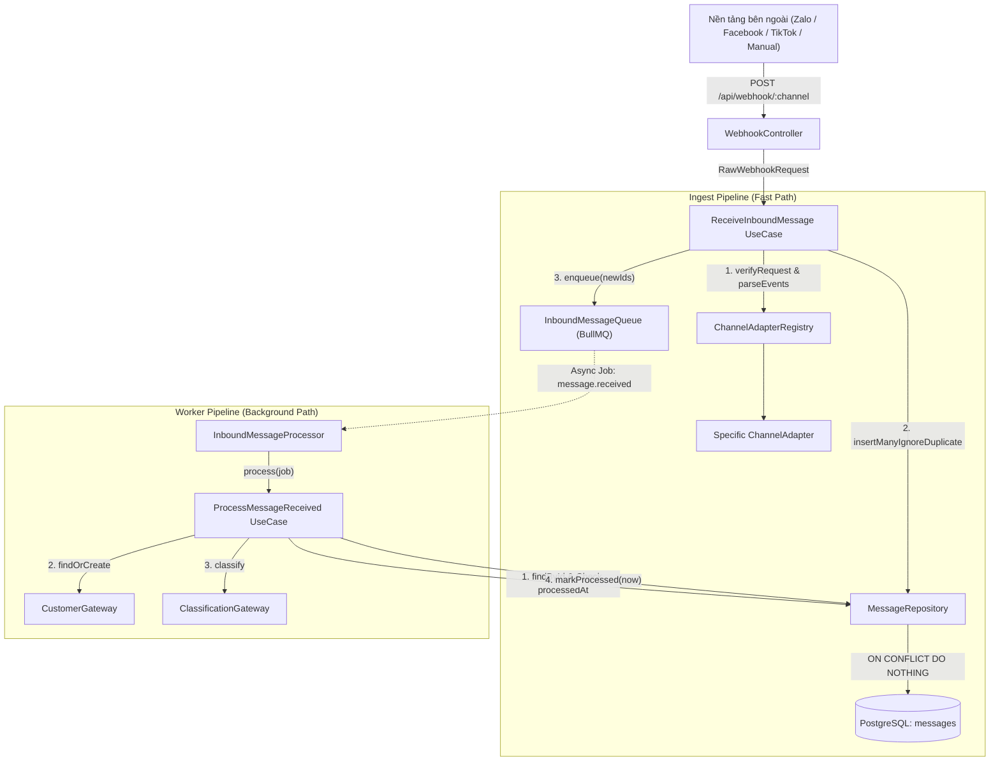
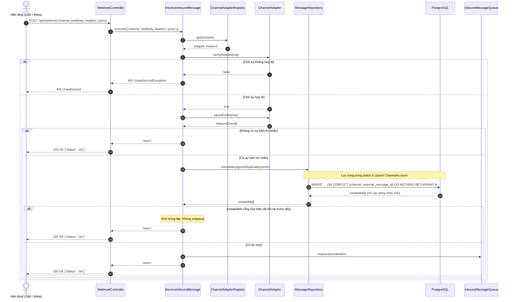
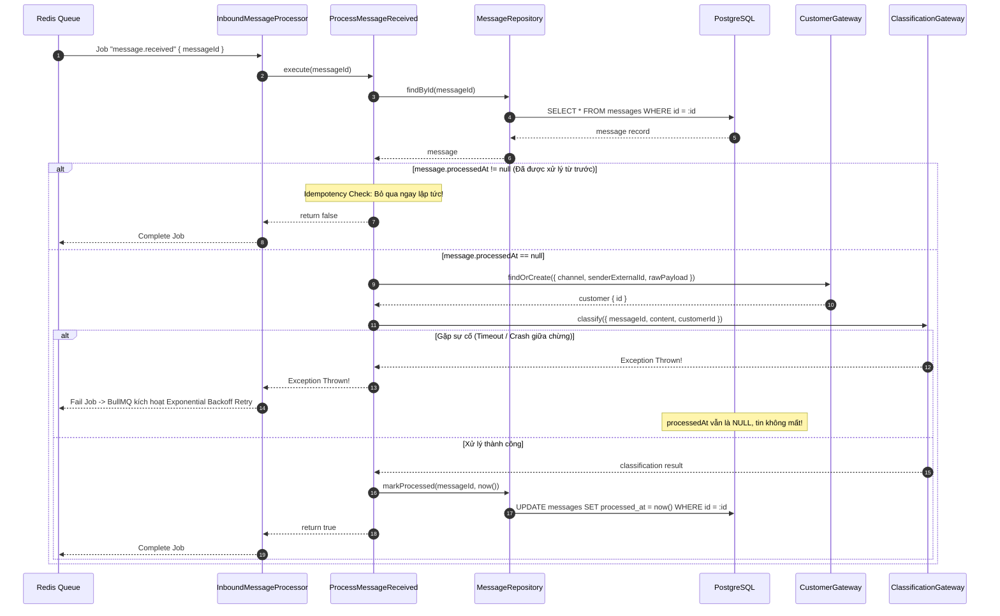

# Tài liệu Kỹ thuật và Nghiệp vụ Module Messaging

Module **Messaging** chịu trách nhiệm tiếp nhận, chuẩn hóa, lưu trữ và xử lý các tin nhắn từ các nền tảng giao tiếp đa kênh (Zalo OA, Facebook Messenger, TikTok, Nhập thủ công) vào hệ thống **CUSC Recruitment CRM**.

---

## 1. Mục tiêu & Nguyên tắc Thiết kế

### 1.1. Mục tiêu Nghiệp vụ
- **Thu thập dữ liệu tập trung**: Hợp nhất các luồng tin nhắn tư vấn từ các kênh mạng xã hội về một cơ sở dữ liệu duy nhất.
- **Bảo mật và toàn vẹn**: Xác thực danh tính nền tảng gửi webhook qua chữ ký số (HMAC-SHA256), chống giả mạo request.
- **Phản hồi tức thì (Fast Ack)**: Phản hồi webhook trong vòng dưới 200ms để không bị các nhà cung cấp nền tảng (Meta, Zalo) hủy webhook hoặc đánh dấu server lỗi.
- **Không mất mát & không trùng lặp (Exactly-once Ingestion & Idempotent Processing)**: Đảm bảo dù mạng chập chờn hay webhook gửi lại nhiều lần, tin nhắn không bao giờ bị mất và không sinh ra dữ liệu thừa hay xử lý trùng lặp.

### 1.2. Nguyên tắc Kiến trúc (Hexagonal / Clean Architecture)
Module được tổ chức theo 4 lớp độc lập:
1. **Domain Layer**: Chứa thực thể dữ liệu nghiệp vụ (`Channel`, `InboundEvent`), các Exceptions và các Port Interfaces (`ChannelAdapter`, `InboundMessageQueue`, `CustomerGateway`, `ClassificationGateway`). Không phụ thuộc bất kỳ framework hay thư viện bên ngoài nào.
2. **Application Layer**: Chứa các Use Cases điều phối luồng nghiệp vụ:
   - `ReceiveInboundMessage`: Tiếp nhận request webhook, xác thực chữ ký, phân giải sự kiện, lưu DB và đẩy vào hàng đợi.
   - `ProcessMessageReceived`: Nhận job từ Worker, tìm/tạo khách hàng, phân loại nội dung tin nhắn và cập nhật trạng thái.
   - `ChannelAdapterRegistry`: Quản lý và định tuyến các Adapter theo kênh.
3. **Infrastructure Layer**: Triển khai cụ thể các Ports:
   - `MessageRepository`: Tương tác cơ sở dữ liệu PostgreSQL qua Prisma, xử lý ràng buộc khoá ngoại và `ON CONFLICT DO NOTHING`.
   - `BullMqInboundQueue` & `InboundMessageProcessor`: Hàng đợi phân tán Redis BullMQ với chiến lược Exponential Backoff Retry.
   - Các Channel Adapters: `ZaloAdapter`, `FacebookAdapter`, `ManualImportAdapter`.
   - Các Gateways: `DefaultCustomerGateway`, `DefaultClassificationGateway`.
4. **Presentation Layer**:
   - `WebhookController`: REST API endpoint `/api/webhook/:channel` nhận Fastify rawBody.

---

## 2. Chuẩn hóa Yêu cầu Nghiệp vụ (Business Requirements)

| Mã YC | Tên Yêu cầu | Chi tiết Nghiệp vụ | Tiêu chuẩn Chấp thuận (DoD) |
| :--- | :--- | :--- | :--- |
| **BR-01** | **Multi-channel Ingestion** | Tiếp nhận tin nhắn từ Zalo OA, Facebook Page, TikTok Shop/Business, và import thủ công. | Hỗ trợ enum `Channel`: `ZALO`, `FACEBOOK`, `TIKTOK`, `MANUAL_IMPORT`. |
| **BR-02** | **Webhook Signature Verification** | Kiểm tra tính hợp lệ của request qua chữ ký số (VD: `x-hub-signature-256`, `x-zalo-signature`). | Bác bỏ lập tức (HTTP 401 Unauthorized) nếu chữ ký sai hoặc bị can thiệp body; không lưu DB và không push job. |
| **BR-03** | **Fast Webhook Acknowledgment** | Webhook endpoint chỉ làm nhiệm vụ lưu tin vào DB và enqueue, không thực hiện các logic nặng (phân loại AI, gọi bên thứ ba) trong request HTTP. | Trả về HTTP 200 `{"status": "ok"}` trong < 200ms. |
| **BR-04** | **Anti-duplicate Ingestion** | Tận dụng ràng buộc `UNIQUE(channel, external_message_id)` và `ON CONFLICT DO NOTHING`. | Gửi cùng 1 sự kiện 10 lần liên tiếp hoặc gửi batch 10 tin trùng lặp chỉ tạo duy nhất 1 dòng tin trong DB và chỉ enqueue đúng 1 job. |
| **BR-05** | **Channel Account Auto-binding** | Tin nhắn gắn liền với tài khoản kênh quản lý (`ChannelAccount`). Tự động nhận diện hoặc khởi tạo tài khoản nếu chưa có. | Không phát sinh lỗi Foreign Key Constraint `messages_channel_account_id_fkey`. |
| **BR-06** | **Idempotent Worker Processing** | Xử lý tin nhắn bất biến. Khi Worker tắt giữa chừng rồi bật lại, tin không bị mất và không bị xử lý hai lần. | Nếu `processed_at != null`, Worker bỏ qua ngay lập tức, không gọi lại logic tạo khách hay phân loại. |
| **BR-07** | **Fault Tolerance & Retry** | Khi xử lý Worker gặp sự cố (AI service timeout, DB lỗi), tự động thử lại. | Cấu hình BullMQ: `attempts = 5`, `backoff = exponential (delay 2000ms)`. |
| **MSG-06** | **Manual Entry & CSV Import** | Nhập tay và Import CSV tải CSV (kênh, người gửi, nội dung, thời gian), kiểm tra bằng Zod, báo từng dòng lỗi. | Import 100 dòng: các dòng lỗi được liệt kê rõ số dòng và lý do, các dòng hợp lệ được lưu vào DB và enqueue. |

---

## 3. Luồng Hoạt động Chi tiết (Workflows)

### 3.1. Sơ đồ Tổng thể Kiến trúc



---

### 3.2. Luồng Ingestion (Tiếp nhận & Khử trùng lặp HTTP)



---

### 3.3. Luồng Worker Xử lý Asynchronous & Chống Xử lý 2 lần (Idempotency)



---

## 4. Đặc tả Cơ sở Dữ liệu & Ràng buộc Toàn vẹn

### 4.1. Bảng `channel_accounts`
Lưu trữ thông tin các tài khoản kết nối từ các kênh (ví dụ: Zalo Official Account ID, Fanpage ID).

| Cột | Kiểu | Ràng buộc | Mô tả |
| :--- | :--- | :--- | :--- |
| `id` | `UUID` | PRIMARY KEY | ID định danh duy nhất |
| `channel` | `enum (Channel)` | NOT NULL | Kênh (`ZALO`, `FACEBOOK`, `TIKTOK`, `MANUAL_IMPORT`) |
| `external_account_id`| `VARCHAR` | NOT NULL | ID định danh tài khoản từ nhà cung cấp |
| `display_name` | `VARCHAR` | NOT NULL | Tên hiển thị của trang/OA |
| `is_active` | `BOOLEAN` | DEFAULT true | Trạng thái hoạt động |
| `created_at` | `TIMESTAMPTZ` | DEFAULT now() | Thời điểm tạo |
| `updated_at` | `TIMESTAMPTZ` | DEFAULT now() | Thời điểm cập nhật |

> **Ràng buộc duy nhất**: `@@unique([channel, externalAccountId])`

### 4.2. Bảng `messages`
Lưu trữ toàn bộ nội dung tin nhắn gửi vào hoặc gửi ra.

| Cột | Kiểu | Ràng buộc | Mô tả |
| :--- | :--- | :--- | :--- |
| `id` | `UUID` | PRIMARY KEY | Khóa chính tin nhắn |
| `channel_account_id` | `UUID` | FOREIGN KEY | Liên kết `channel_accounts.id` (ON DELETE RESTRICT) |
| `channel` | `enum (Channel)` | NOT NULL | Kênh nhận tin nhắn |
| `direction` | `enum (MessageDirection)` | NOT NULL | Chiều tin nhắn (`INBOUND` / `OUTBOUND`) |
| `content` | `TEXT` | NULLABLE | Nội dung tin nhắn văn bản |
| `sent_at` | `TIMESTAMPTZ` | NOT NULL | Thời điểm gửi từ nền tảng gốc |
| `external_message_id`| `VARCHAR` | NOT NULL | ID tin nhắn duy nhất do nền tảng cấp |
| `raw_payload` | `JSONB` | NOT NULL | Toàn bộ payload nguyên bản nhận từ Webhook |
| `processed_at` | `TIMESTAMPTZ` | NULLABLE | Thời điểm tin nhắn được xử lý xong bởi Worker |
| `created_at` | `TIMESTAMPTZ` | DEFAULT now() | Thời điểm ghi nhận vào hệ thống |

> **Ràng buộc khử trùng lặp**: `@@unique([channel, externalMessageId])`  
> **Chỉ mục truy vấn**: `@@index([channelAccountId, sentAt])`

---

## 5. Hướng dẫn Triển khai & Cấu hình

### 5.1. Cấu trúc Source Code
```text
apps/api/src/modules/messaging/
├── domain/                                 # Lớp Domain thuần túy
│   ├── channel.ts                          # Enum Channel & MessageDirection
│   ├── inbound-event.ts                    # InboundEvent Interface
│   ├── channel-adapter.port.ts             # Port ChannelAdapter & Queue
│   ├── customer-gateway.port.ts            # Port CustomerGateway
│   ├── classification-gateway.port.ts      # Port ClassificationGateway
│   └── index.ts
├── application/                            # Lớp Application (Use Cases)
│   ├── channel-adapter.registry.ts         # Quản lý & tra cứu Adapter
│   ├── receive-inbound-message.usecase.ts  # Ingest Webhook Use Case
│   └── process-message-received.usecase.ts # Worker Processing Use Case
├── infrastructure/                         # Lớp Infrastructure (Adapters & DB)
│   ├── message.repository.ts               # Prisma Repository với ON CONFLICT
│   ├── bullmq-inbound-queue.ts             # BullMQ Queue & Worker Processor
│   ├── adapters/                           # Triển khai Channel Adapters
│   │   ├── zalo.adapter.ts
│   │   ├── facebook.adapter.ts
│   │   └── manual-import.adapter.ts
│   └── gateways/                           # Triển khai Gateway mặc định
│       ├── default-customer.gateway.ts
│       └── default-classification.gateway.ts
├── presentation/                           # Lớp Presentation
│   └── webhook.controller.ts               # Fastify Webhook Controller
├── messaging.module.ts                     # NestJS Module Assembly
└── index.ts                                # Public Module API
```

### 5.2. Đăng ký Module trong NestJS
Để module hoạt động, `MessagingModule` được import trong `AppModule`:
```typescript
@Module({
  imports: [AppConfigModule, HealthModule, AuthModule, MessagingModule],
  controllers: [AppController],
  providers: [AppService],
})
export class AppModule {}
```

---

## 6. Tiêu chuẩn Nghiệm thu & Hướng dẫn Kiểm thử

### 6.1. Ma trận Kiểm thử Tự động (Automated Test Matrix)

| Test Suite File | Kiểu Test | Nội dung Kiểm thử | Kết quả |
| :--- | :--- | :--- | :--- |
| `fake-channel-adapter.e2e.spec.ts` | Unit/Contract | Kiểm tra tính toán chữ ký HMAC SHA256, phát hiện payload sai cấu trúc, parse đa sự kiện. | **PASSED** (5 tests) |
| `receive-inbound-message.spec.ts` | Unit UseCase | Kiểm tra xác thực chữ ký (401), xử lý hợp lệ, và xác minh gửi 10 lần chỉ enqueue đúng 1 job. | **PASSED** (4 tests) |
| `webhook.controller.spec.ts` | Unit Controller | Bắt lỗi thiếu rawBody (400), truyền đầy đủ params/headers/query vào use case. | **PASSED** (2 tests) |
| `process-message-received.spec.ts` | Unit Worker | Kiểm tra quy trình xử lý 4 bước, Idempotency check (`processedAt != null`), và cơ chế Retry khi lỗi. | **PASSED** (4 tests) |
| `message-unique.e2e-spec.ts` | Database E2E | Kiểm tra ràng buộc duy nhất trên PostgreSQL thật với `@@unique([channel, externalMessageId])`. | **PASSED** (2 tests) |
| `anti-duplicate.e2e-spec.ts` | Database E2E | Gửi cùng 1 sự kiện 10 lần liên tiếp vào hệ thống thật: DB có đúng 1 dòng, Queue có đúng 1 job. | **PASSED** (2 tests) |
| `worker-idempotency.e2e-spec.ts` | Database E2E | Mô phỏng tắt worker giữa chừng rồi bật lại: tin không mất và không bao giờ bị xử lý 2 lần. | **PASSED** (1 test) |
| `csv-parser.spec.ts` | Unit Parser | Phân tích cú pháp RFC-4180 CSV, BOM UTF-8, dấu ngoặc kép, tạo file mẫu. | **PASSED** (4 tests) |
| `import-messages.usecase.spec.ts` | Unit UseCase | Kiểm tra kiểm thực Zod, báo lỗi từng dòng, tiêu chuẩn DoD import 100 dòng. | **PASSED** (4 tests) |
| `message-import.controller.spec.ts` | Unit Controller | API tải template CSV, import JSON thủ công, import CSV file và kiểm tra lỗi. | **PASSED** (5 tests) |

### 6.2. Lệnh Chạy Toàn bộ Kiểm thử

```bash
# 1. Chạy toàn bộ Unit Tests của API (19 tests)
pnpm --filter api test

# 2. Chạy toàn bộ E2E Database Tests trên PostgreSQL thật (6 tests)
pnpm --filter api test:e2e

# 3. Kiểm tra tính toàn vẹn kiểu dữ liệu (TypeScript Typecheck)
pnpm --filter api typecheck

# 4. Kiểm tra biên dịch NestJS Production Build
pnpm --filter api build

# 5. Kiểm tra mã nguồn qua Linter
pnpm --filter api lint
```

### 6.3. Kiểm thử Thủ công qua cURL / Postman

#### Kịch bản 1: Nhập tin thủ công hợp lệ
```bash
curl -X POST http://localhost:3000/api/webhook/MANUAL_IMPORT \
  -H "Content-Type: application/json" \
  -d '{
    "events": [
      {
        "account": "oa-ct-01",
        "messageId": "msg-import-001",
        "sender": "candidate-01",
        "text": "Em muốn đăng ký xét tuyển khoá Kỹ thuật phần mềm",
        "sentAt": "2026-10-23T08:00:00.000Z"
      }
    ]
  }'
```
*Kết quả kỳ vọng:* `HTTP 200 OK` $\rightarrow$ `{"status": "ok"}`

#### Kịch bản 2: Gửi lại cùng một tin nhắn 10 lần
Chạy lại lệnh cURL trên 10 lần liên tiếp.
*Kết quả kỳ vọng:*
- Mọi request đều trả về `HTTP 200 OK {"status": "ok"}`.
- Kiểm tra cơ sở dữ liệu: `SELECT count(*) FROM messages WHERE external_message_id = 'msg-import-001'` $\rightarrow$ Trả về đúng **1**.
- Worker logs chỉ xử lý đúng **1 lần duy nhất**, các lần sau kích hoạt cơ chế `ON CONFLICT DO NOTHING` và không sinh thêm job.

#### Kịch bản 3: Tải file mẫu CSV (MSG-06)
```bash
curl -X GET http://localhost:3000/api/messages/import/template -o import_template.csv
```
*Kết quả kỳ vọng:* Tải về file `import_template.csv` có header `kênh,người gửi,nội dung,thời gian` và dữ liệu mẫu.

#### Kịch bản 4: Nhập tay tin nhắn kiểm tra bằng Zod (MSG-06)
```bash
curl -X POST http://localhost:3000/api/messages/import/manual \
  -H "Content-Type: application/json" \
  -d '{
    "items": [
      {
        "kênh": "ZALO",
        "người gửi": "0912345678",
        "nội dung": "Tư vấn tuyển sinh khóa Lập trình",
        "thời gian": "2026-10-24T10:00:00Z"
      },
      {
        "kênh": "INVALID_CHANNEL",
        "người gửi": "",
        "nội dung": "Dòng bị lỗi",
        "thời gian": "invalid_date"
      }
    ]
  }'
```
*Kết quả kỳ vọng:* Trả về JSON với `total: 2`, `successCount: 1`, `errorCount: 1`, `errors: [{"row": 2, "reason": "kênh: Kênh không hợp lệ...; người gửi: Người gửi không được để trống; thời gian: Thời gian không đúng định dạng..."}]`.

#### Kịch bản 5: Import file CSV và báo từng dòng lỗi (MSG-06)
```bash
curl -X POST http://localhost:3000/api/messages/import/csv \
  -H "Content-Type: application/json" \
  -d '{
    "csvContent": "kênh,người gửi,nội dung,thời gian\nZALO,0901234567,Học phí khóa Web,2026-10-24T08:00:00Z\nFACEBOOK,,Thiếu người gửi,2026-10-24T08:05:00Z"
  }'
```
*Kết quả kỳ vọng:* Trả về thống kê import và danh sách dòng lỗi ghi rõ số dòng (row, csvLine) và lý do kiểm thực từ Zod.
