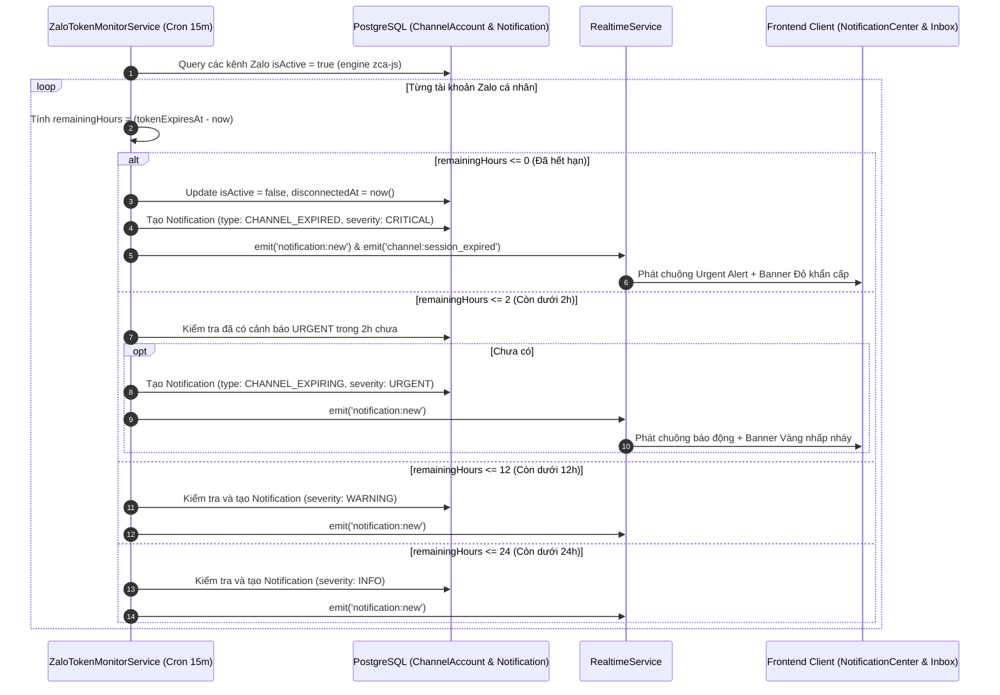
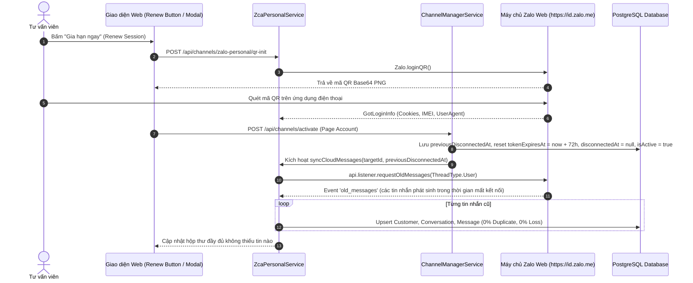

# Tài liệu Kỹ thuật: Hộp Lưu Thông Báo (Workspace Notification Center) & Giám Sát Thời Hạn Zalo Cá Nhân (zca-js)

Tài liệu này chuẩn hóa kiến trúc, cơ sở dữ liệu, luồng nghiệp vụ, API endpoints và chi tiết hiện thực cho bộ tính năng:
1. **Hộp lưu thông báo trung tâm (Workspace Notification Center)**.
2. **Hệ thống giám sát thời hạn Zalo cá nhân (zca-js Token Expiry Monitor)** kèm **Bộ đếm ngược Countdown trực quan** và **Nút Gia hạn nhanh (Renew Session)**.
3. **Cơ chế tự động đồng bộ bù chống mất tin nhắn (Auto Backfill Sync)** khi kết nối lại phiên làm việc.

---

## 1. Tổng quan & Mục tiêu Kỹ thuật

### 1.1. Bối cảnh Nghiệp vụ
- **Giới hạn phiên Zalo cá nhân (zca-js)**: Zalo Web cấp phiên làm việc bằng Cookie và IMEI có thời hạn tối đa 72 giờ (3 ngày). Khi hết hạn hoặc bị người dùng đăng xuất trên điện thoại (mã WebSocket 3000, 3003, 1006), kết nối bị ngắt đột ngột khiến tư vấn viên không nhận được tin nhắn của khách hàng.
- **Rủi ro mất tin nhắn**: Trong khoảng thời gian từ lúc phiên Zalo bị ngắt (`disconnectedAt`) đến khi tư vấn viên quét mã đăng nhập lại, các tin nhắn khách hàng gửi đến tài khoản Zalo cá nhân có nguy cơ bị bỏ sót 100% nếu không có cơ chế kéo bù lịch sử tin nhắn từ Cloud.
- **Thiếu trung tâm cảnh báo tập trung**: Trước đây, các thông báo chỉ hiển thị Toast tạm thời, nếu tư vấn viên rời bàn làm việc thì cảnh báo biến mất. Do đó cần **Hộp lưu thông báo trung tâm (Notification Center)** lưu trữ vĩnh viễn theo Workspace, có badge đếm số lượng, phân loại mức độ nghiêm trọng và phát âm thanh cảnh báo kịp thời.

### 1.2. Mục tiêu Kỹ thuật
- **Zero-Message-Loss (0% Mất tin nhắn)**: Cơ chế Auto Backfill Sync tự động kích hoạt `api.listener.requestOldMessages(ThreadType.User)` ngay khi đăng nhập lại, bù đắp toàn bộ tin nhắn phát sinh trong thời gian gián đoạn.
- **Proactive Expiry Warning (Cảnh báo chủ động theo bậc thời gian)**: Quét tự động mỗi 15 phút, phát cảnh báo đa cấp độ: $\le$ 24h (`INFO`), $\le$ 12h (`WARNING`), $\le$ 2h (`URGENT` kèm chuông báo động), và khi ngắt kết nối (`CRITICAL`).
- **One-Click Renewal (Gia hạn 1 chạm)**: Tư vấn viên có thể chủ động bấm "Gia hạn ngay" (Renew Session) vào đầu giờ làm việc để làm mới chu kỳ 72 giờ mà không cần đợi bị ngắt kết nối.
- **Độ trễ thông báo thời gian thực (Realtime Dispatch)**: Sự kiện `notification:new` truyền tức thời qua WebSocket + SSE đến trình duyệt của toàn bộ chuyên viên trong Workspace.

---

## 2. Bảng Tiêu chuẩn Chấp thuận (DoD)

| Mã YC | Hạng mục | Chi tiết Kỹ thuật | Tiêu chuẩn Chấp thuận (DoD) |
| :--- | :--- | :--- | :--- |
| **NT-01** | **Database Model `Notification`** | Tạo model `Notification` trong `notification.prisma` với đầy đủ `workspaceId`, `type`, `severity`, `title`, `content`, `actionUrl`, `isRead`, `metadata`, `createdAt`, composite index. | Migrate thành công, quan hệ Cascade với `Workspace`. Tự động tạo bảng qua DDL của `PrismaService`. |
| **NT-02** | **ChannelAccount Extension** | Bổ sung `tokenExpiresAt` và `disconnectedAt` vào model `ChannelAccount` trong `messaging.prisma`. | Lưu trữ chính xác mốc thời gian hết hạn 72h và thời điểm ngắt kết nối. |
| **NT-03** | **Notification REST API & Service** | Cung cấp đầy đủ REST API: `GET /api/v1/workspaces/:wsId/notifications`, `PATCH .../:id/read`, `POST .../read-all`, `DELETE .../:id`. | Lọc theo `isRead`, `type`, `severity`, hỗ trợ phân trang chuẩn xác và đếm unread count. |
| **NT-04** | **Cron Scheduler Monitor** | `ZaloTokenMonitorService` quét mỗi 15 phút (`@Cron('0 */15 * * * *')`) các tài khoản Zalo cá nhân. | Đặt `tokenExpiresAt = +72h` nếu thiếu. Bắn thông báo `INFO` ($\le$ 24h), `WARNING` ($\le$ 12h), `URGENT` ($\le$ 2h), `CRITICAL` (khi hết hạn hoặc bị ngắt). |
| **NT-05** | **Auto Backfill Sync** | Khi quét QR đăng nhập thành công, reset `tokenExpiresAt = now + 72h`, xóa `disconnectedAt`, tự động kích hoạt `syncCloudMessages(targetId, previousDisconnectedAt)`. | Gọi `api.listener.requestOldMessages(ThreadType.User)`, upsert hội thoại và tin nhắn cũ vào DB. |
| **NT-06** | **Frontend Notification Center** | Icon Chuông trên Header Navbar (`HeaderLayout.tsx`), badge đỏ đếm chưa đọc, popover danh sách icon theo severity, thời gian relative, nút đọc tất cả. | Tự động tăng badge và phát âm thanh chuông cảnh báo (`playUrgentAlertSound`) khi có thông báo `URGENT` / `CRITICAL`. |
| **NT-07** | **Countdown Timer & Renew Button** | Hiển thị thanh tiến trình và bộ đếm ngược trực quan trên thẻ Zalo cá nhân (`WorkspaceChannelsTab.tsx`): Xanh ($\ge$ 12h) $\rightarrow$ Vàng (< 12h) $\rightarrow$ Đỏ (< 2h). Nút "Gia hạn ngay". | Cập nhật đếm ngược mỗi 30s. Bấm "Gia hạn ngay" mở modal quét mã QR làm mới phiên bất cứ lúc nào. |
| **NT-08** | **Inbox Alert Banner** | Banner màu đỏ/vàng trên Header của Live Chat (`UnifiedInboxPage.tsx`) nếu Zalo cá nhân sắp hết hạn (< 2h) hoặc đã ngắt kết nối. | Cảnh báo rõ ràng kèm nút "Quét lại mã ngay" / "Gia hạn ngay", đồng bộ với socket realtime. |

---

## 3. Kiến trúc Cơ sở Dữ liệu (Prisma Schema)

### 3.1. Model `Notification` (`apps/api/prisma/schema/notification.prisma`)

```prisma
enum NotificationType {
    CHANNEL_EXPIRING
    CHANNEL_EXPIRED
    NEW_LEAD
    SYSTEM_WARNING
    CONVERSATION_ALERT

    @@map("notification_type")
}

enum NotificationSeverity {
    INFO
    WARNING
    URGENT
    CRITICAL

    @@map("notification_severity")
}

model Notification {
    id          String               @id @default(uuid()) @db.Uuid
    workspaceId String               @map("workspace_id") @db.Uuid
    type        NotificationType
    severity    NotificationSeverity
    title       String               @db.VarChar(255)
    content     String               @db.Text
    actionUrl   String?              @map("action_url") @db.VarChar(500)
    isRead      Boolean              @default(false) @map("is_read")
    metadata    Json?                @db.JsonB
    createdAt   DateTime             @default(now()) @map("created_at") @db.Timestamptz(3)

    workspace   Workspace            @relation(fields: [workspaceId], references: [id], onDelete: Cascade)

    @@index([workspaceId, isRead, createdAt])
    @@map("notifications")
}
```

### 3.2. Cập nhật Model `ChannelAccount` (`apps/api/prisma/schema/messaging.prisma`)

```prisma
model ChannelAccount {
    id                  String    @id @default(uuid()) @db.Uuid
    workspaceId         String?   @map("workspace_id") @db.Uuid
    channel             Channel
    externalAccountId   String    @map("external_account_id")
    displayName         String    @map("display_name")
    avatarUrl           String?   @map("avatar_url")
    encryptedAccessToken String?  @map("encrypted_access_token") @db.Text
    refreshToken        String?   @map("refresh_token") @db.Text
    tokenExpiresAt      DateTime? @map("token_expires_at") @db.Timestamptz(3)
    disconnectedAt      DateTime? @map("disconnected_at") @db.Timestamptz(3)
    isWebhookSubscribed Boolean   @default(false) @map("is_webhook_subscribed")
    metadata            Json?     @map("metadata") @db.JsonB
    isActive            Boolean   @default(true) @map("is_active")
    createdAt           DateTime  @default(now()) @map("created_at") @db.Timestamptz(3)
    updatedAt           DateTime  @default(now()) @updatedAt @map("updated_at") @db.Timestamptz(3)

    workspace           Workspace?     @relation(fields: [workspaceId], references: [id], onDelete: Cascade)
    messages            Message[]
    conversations       Conversation[]

    @@unique([channel, externalAccountId])
    @@index([workspaceId])
    @@map("channel_accounts")
}
```

---

## 4. Luồng Nghiệp vụ & Biểu đồ Tuần tự (Sequence Diagrams)

### 4.1. Luồng Giám sát & Cảnh báo Hết hạn (Cron Job 15 phút)



### 4.2. Luồng Gia hạn / Đăng nhập lại & Đồng bộ bù tin nhắn (Auto Backfill Sync)



---

## 5. Chi tiết Hiện thực Backend (NestJS)

### 5.1. Module Notification (`apps/api/src/modules/notification`)
- **`NotificationService`**:
  - `create(dto)`: Lưu bản ghi vào bảng `notifications`, tự động gọi `realtimeService.broadcastNotification()` để gửi payload realtime `notification:new` tới các client WebSocket và SSE.
  - `findAll(workspaceId, filter)`: Hỗ trợ lọc theo `isRead`, `type`, `severity`, phân trang `page`, `limit` (tối đa 100), tính toán tổng số bản ghi và số lượng chưa đọc (`unreadCount`).
  - `markAsRead(workspaceId, id)`: Cập nhật `isRead: true` cho 1 thông báo cụ thể.
  - `markAllAsRead(workspaceId)`: Đánh dấu tất cả thông báo của Workspace là đã đọc.
  - `delete(workspaceId, id)`: Xóa thông báo khỏi cơ sở dữ liệu.
- **`NotificationController`**:
  - Đăng ký dưới route `v1/workspaces/:wsId/notifications` (tương ứng `/api/v1/workspaces/:wsId/notifications` sau khi Fastify áp dụng global prefix `/api`).

### 5.2. Token Expiry & Monitor Service (`apps/api/src/modules/channel-connection/application/zalo-token-monitor.service.ts`)
- Đăng ký `@Cron('0 */15 * * * *')` thông qua `@nestjs/schedule` (`ScheduleModule.forRoot()`).
- Tích hợp hook `OnApplicationBootstrap` để quét kiểm tra ngay khi máy chủ khởi động.
- Tránh spam thông báo bằng cách kiểm tra lịch sử thông báo đã phát trong khoảng thời gian tương ứng (2 giờ cho `URGENT`, 12 giờ cho `WARNING`, 24 giờ cho `INFO`).

### 5.3. Xử lý Sự kiện Ngắt kết nối trong `ZcaPersonalService`
- Khi listener của `zca-js` bắt sự kiện WebSocket bị đóng (`code 3000`, `3003`, `1006`, `1000`):
  ```typescript
  await this.prisma.channelAccount.update({
    where: { id: channelAccount.id },
    data: {
      isActive: false,
      disconnectedAt: now,
      metadata: { ...meta, deactivatedReason: 'SESSION_EXPIRED', lastExpiredAt: now.toISOString() },
    },
  });
  await this.notificationService.create({
    workspaceId: channelAccount.workspaceId,
    type: NotificationType.CHANNEL_EXPIRED,
    severity: NotificationSeverity.CRITICAL,
    title: `Kết nối Zalo cá nhân "${channelAccount.displayName}" bị ngắt kết nối`,
    content: `Phiên kết nối Zalo đã bị ngắt (${reason}). Vui lòng quét mã QR để kết nối lại và đồng bộ bù tin nhắn.`,
    actionUrl: '/settings/channels?reconnect=zalo',
    metadata: { channelAccountId: channelAccount.id, reason, disconnectedAt: now.toISOString() },
  });
  ```

---

## 6. Chi tiết Hiện thực Frontend (React + Tailwind + Lucide Icons)

### 6.1. Hộp Lưu Thông Báo: `NotificationCenter.tsx`
- **Vị trí**: Đặt tại thanh Navbar Header [`HeaderLayout.tsx`](file:///d:/Information%20Technology/Personal-Project/Recruiment-CRM/CUSC-Recruitment-CRM/apps/web/src/layouts/HeaderLayout.tsx) cạnh `WorkspaceSwitcher` và `StaffPresenceSelector`.
- **Badge**: Hiển thị số lượng thông báo chưa đọc, tự động rung nhấp nháy (pulse/bounce) khi nhận thông báo mới.
- **Popover Dropdown**:
  - Phân loại trực quan bằng màu nền và icon:
    - `CRITICAL`: Đỏ đậm, icon `ShieldAlert`.
    - `URGENT`: Cam đỏ, icon `AlertCircle`.
    - `WARNING`: Vàng cam, icon `AlertTriangle`.
    - `INFO`: Xanh lam, icon `Info`.
  - Hiển thị thời gian tương đối: "Vừa xong", "15 phút trước", "2 giờ trước", "Hôm qua".
  - Nút "Đọc tất cả" và các tab lọc "Tất cả" / "Chưa đọc".
  - Click vào thông báo sẽ tự động đánh dấu đã đọc và điều hướng theo `actionUrl`.
- **Âm thanh cảnh báo**:
  - Sử dụng Web Audio API synthesizer trong [`audioNotification.ts`](file:///d:/Information%20Technology/Personal-Project/Recruiment-CRM/CUSC-Recruitment-CRM/apps/web/src/modules/realtime/audioNotification.ts).
  - Hàm `playUrgentAlertSound()` tổng hợp 3 nốt chuông báo động dồn dập khi nhận sự kiện `URGENT` hoặc `CRITICAL`, không phụ thuộc file mp3 ngoài.

### 6.2. Bộ đếm ngược Countdown & Nút Gia Hạn Nhanh: `ZaloTokenCountdown.tsx`
- Tích hợp vào thẻ Zalo cá nhân trong [`WorkspaceChannelsTab.tsx`](file:///d:/Information%20Technology/Personal-Project/Recruiment-CRM/CUSC-Recruitment-CRM/apps/web/src/modules/onboarding/components/workspace/tabs/WorkspaceChannelsTab.tsx).
- Thanh tiến trình phần trăm trực quan trên chu kỳ chuẩn 72 giờ:
  - **Màu Xanh lá**: Khi thời hạn còn $\ge$ 12 giờ.
  - **Màu Vàng cam**: Khi thời hạn còn < 12 giờ.
  - **Màu Đỏ nhấp nháy**: Khi thời hạn còn < 2 giờ hoặc đã hết hạn/ngắt kết nối.
- Nút **"Gia hạn ngay" (Renew Session)**: Cho phép tư vấn viên chủ động mở popup quét mã QR Zalo làm mới lại phiên bất cứ thời điểm nào mà không cần chờ bị ngắt kết nối.

### 6.3. Banner Cảnh báo tại Hộp thư Live Chat: `InboxZaloAlertBanner.tsx`
- Tích hợp tại đầu [`UnifiedInboxPage.tsx`](file:///d:/Information%20Technology/Personal-Project/Recruiment-CRM/CUSC-Recruitment-CRM/apps/web/src/modules/inbox/pages/UnifiedInboxPage.tsx).
- Khi phát hiện tài khoản Zalo cá nhân sắp hết hạn (< 2 giờ) hoặc đã ngắt kết nối:
  - Hiển thị dải banner nổi bật với cảnh báo tương ứng.
  - Có nút tắt tạm thời hoặc nút "Quét lại mã ngay" / "Gia hạn ngay" để xử lý tức thì.

---

## 7. Hướng dẫn Kiểm thử & Nghiệm thu (Verification Guide)

1. **Kiểm tra biên dịch Typecheck & Build**:
   ```powershell
   # Backend API
   corepack pnpm --filter api typecheck
   corepack pnpm --filter api build

   # Frontend Web
   corepack pnpm --filter web build
   ```
2. **Kiểm tra API Thông báo**:
   - `GET /api/v1/workspaces/:wsId/notifications`: Trả về mảng danh sách thông báo kèm `unreadCount`.
   - `PATCH /api/v1/workspaces/:wsId/notifications/:id/read`: Đánh dấu thông báo đã đọc, `isRead` chuyển thành `true`.
   - `POST /api/v1/workspaces/:wsId/notifications/read-all`: Đánh dấu tất cả là đã đọc.
3. **Kiểm tra Cron Scheduler & Countdown**:
   - Khi server khởi động, kiểm tra log: `[ZaloTokenMonitor] Bắt đầu chu kỳ quét định kỳ 15 phút...`.
   - Quan sát thẻ Zalo cá nhân trong mục Cài đặt Kênh: Đếm ngược hiển thị chính xác số giờ, số phút còn lại và thanh tiến trình đổi màu theo thời gian thực.
4. **Kiểm tra Auto Backfill Sync**:
   - Giả lập ngắt kết nối hoặc set `disconnectedAt`.
   - Quét mã QR đăng nhập lại: Hệ thống ghi log `[zca-js] Kích hoạt cơ chế Auto Backfill Sync...` và kéo các tin nhắn cũ từ Zalo Cloud về lưu vào cơ sở dữ liệu.
