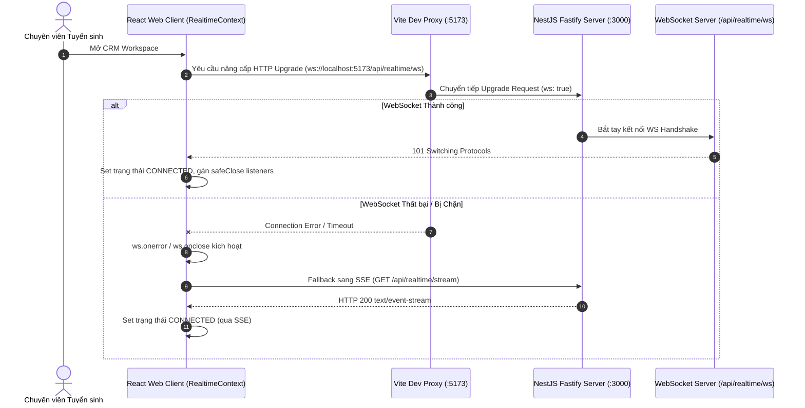
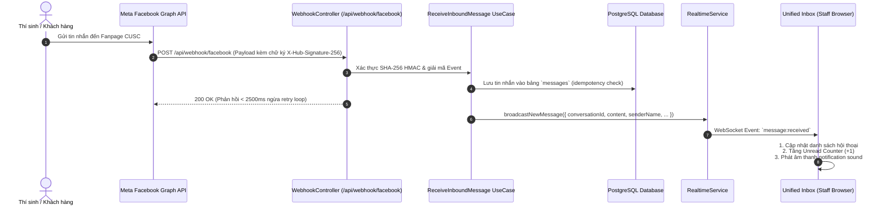

# Tài liệu Kỹ thuật và Kiến trúc Module Realtime & Socket

Tài liệu này chuẩn hóa kiến trúc, luồng hoạt động, cách thức thực hiện, bộ kiểm thử đơn vị (Unit Tests) và kết quả nghiệm thu cho hệ thống truyền nhận thông tin thời gian thực (**Realtime & Socket Engine**) của **CUSC Recruitment CRM**.

---

## 1. Tổng quan & Mục tiêu Kỹ thuật

Hệ thống Realtime đóng vai trò là "hệ thần kinh" của CRM Tuyển sinh đa kênh, đảm bảo thông tin tương tác giữa thí sinh/khách hàng và các chuyên viên tư vấn được cập nhật ngay lập tức mà không cần người dùng tải lại trang (Zero-Refresh Experience).

### 1.1. Mục tiêu Kỹ thuật
- **Độ trễ cực thấp (Sub-50ms Latency)**: Chuyển tiếp ngay lập tức các sự kiện tin nhắn từ Webhook Meta/Zalo đến giao diện Hộp thư tiếp nhận (Unified Inbox).
- **Kiến trúc Hybrid Fallback (WebSocket song hành Server-Sent Events - SSE)**: Ưu tiên thiết lập kết nối hai chiều toàn phần qua WebSocket. Nếu mạng doanh nghiệp chặn WebSocket hoặc gặp sự cố bắt tay, client tự động hạ cấp xuống Server-Sent Events (SSE) để duy trì luồng nhận tin nhắn ổn định.
- **Theo dõi Hiện diện Tư vấn viên (Staff Presence Tracking)**: Cập nhật trạng thái tức thời (`ONLINE`, `BUSY`, `AWAY`, `OFFLINE`) của từng chuyên viên trong workspace, hỗ trợ điều phối thí sinh thông minh.
- **Phát hiện & Phản hồi mượt mà trong React Lifecycle**: Khắc phục triệt để hiện tượng ngắt kết nối đột ngột hoặc cảnh báo *"WebSocket is closed before the connection is established"* khi React Strict Mode mount/unmount component.

---

## 2. Tiêu chuẩn Kỹ thuật & Bảng Yêu cầu (DoD)

| Mã YC | Hạng mục | Chi tiết Kỹ thuật | Tiêu chuẩn Chấp thuận (DoD) |
| :--- | :--- | :--- | :--- |
| **RT-01** | **WebSocket Server Binding** | Gắn `WebSocketServer` (thư viện `ws`) vào HTTP Server nền tảng Fastify tại endpoint `/api/realtime/ws`. | Lắng nghe chính xác cổng API (3000) và qua Vite Dev Proxy (5173). Bắt tay HTTP 101 Switching Protocols thành công. |
| **RT-02** | **SSE Fallback Engine** | Cung cấp endpoint HTTP GET `/api/realtime/stream` truyền dữ liệu dạng `text/event-stream`. | Trả về stream SSE liên tục, hỗ trợ tự động reconnect khi đường truyền mạng biến động. |
| **RT-03** | **Webhook Live Broadcasting** | Khi Webhook nhận tin nhắn mới từ khách hàng, phát broadcast sự kiện `message:received` tới toàn bộ chuyên viên trong workspace. | Tin nhắn xuất hiện ngay trên giao diện hộp thư, tăng số đếm tin chưa đọc và phát âm thanh thông báo. |
| **RT-04** | **Staff Presence Sync** | Quản lý kết nối socket theo từng `staffId`, phát broadcast sự kiện `presence:updated` khi trạng thái thay đổi. | Danh sách tư vấn viên cập nhật màu chấm trạng thái (xanh lá, vàng, đỏ, xám) tức thời. |
| **RT-05** | **Safe Teardown in React** | Xử lý an toàn khi React unmount (đặc biệt Strict Mode) không đóng socket khi đang ở trạng thái `CONNECTING`. | Không xuất hiện lỗi warning trên console trình duyệt; ngắt kết nối dọn sạch tài nguyên bộ nhớ. |

---

## 3. Luồng Hoạt động (Workflows & Sequence Diagrams)

### 3.1. Luồng Bắt tay Kết nối & Fallback Tự động



### 3.2. Luồng Xử lý Tin nhắn Khách hàng: Từ Webhook đến Realtime UI



---

## 4. Cách Thức Thực Hiện (Implementation Details)

### 4.1. Fastify WebSocketServer Attachment
Trong [`realtime.service.ts`](file:///d:/Information%20Technology/Personal-Project/Recruiment-CRM/CUSC-Recruitment-CRM/apps/api/src/modules/realtime/realtime.service.ts), hệ thống tích hợp `ws.WebSocketServer` trực tiếp vào máy chủ HTTP nền của Fastify:
```typescript
attachHttpServer(server: any, path: string = '/api/realtime/ws'): WebSocketServer {
  const wss = new WebSocketServer({ noServer: true });
  this.wss = wss;

  server.on('upgrade', (request: any, socket: any, head: any) => {
    const { pathname } = new URL(request.url, `http://${request.headers.host}`);
    if (pathname === path) {
      wss.handleUpgrade(request, socket, head, (ws) => {
        wss.emit('connection', ws, request);
      });
    }
  });

  wss.on('connection', (ws: WebSocket, req: any) => {
    this.handleClientConnection(ws, req);
  });

  return wss;
}
```

### 4.2. Cơ chế Đóng Socket An toàn (`safeCloseWebSocket`)
Nhằm khắc phục triệt để lỗi hủy socket giữa chừng khi React component mount/unmount trong chế độ phát triển (React 18/19 Strict Mode), [`RealtimeContext.tsx`](file:///d:/Information%20Technology/Personal-Project/Recruiment-CRM/CUSC-Recruitment-CRM/apps/web/src/modules/realtime/RealtimeContext.tsx) áp dụng cơ chế:
```typescript
const safeCloseWebSocket = (ws: WebSocket | null) => {
  if (!ws) return;
  ws.onopen = null;
  ws.onmessage = null;
  ws.onerror = null;
  ws.onclose = null;
  if (ws.readyState === WebSocket.OPEN) {
    ws.close();
  } else if (ws.readyState === WebSocket.CONNECTING) {
    ws.onopen = () => {
      try { ws.close(); } catch {}
    };
  }
};
```

### 4.3. Cấu hình Vite Proxy Hỗ trợ WebSocket
Trong [`vite.config.ts`](file:///d:/Information%20Technology/Personal-Project/Recruiment-CRM/CUSC-Recruitment-CRM/apps/web/vite.config.ts), proxy `/api` được khai báo cờ `ws: true` để chuyển tiếp trơn tru các frame WebSocket từ port `5173` sang port `3000`:
```typescript
const apiProxy = {
  '/api': {
    target: 'http://localhost:3000',
    changeOrigin: true,
    secure: false,
    ws: true,
  },
};
```

---

## 5. Kiểm thử Đơn vị & Tích hợp (Unit & Integration Tests)

Hệ thống Realtime được bảo vệ bởi hai bộ kiểm thử toàn diện:
1. `test/realtime/realtime.socket.spec.ts`: Kiểm thử chi tiết vòng đời kết nối WebSocket, gửi nhận tin nhắn, bắt tay và xử lý ngắt kết nối.
2. `test/realtime/realtime.spec.ts`: Kiểm thử logic broadcast, lọc sự kiện theo workspace và SSE endpoint streaming.

### 5.1. Danh mục Test Cases Chi tiết
- `should accept client connection and increment active clients count`: Xác nhận client kết nối thành công và bộ đếm kết nối hoạt động chính xác.
- `should handle multiple simultaneous connections`: Kiểm tra khả năng phục vụ nhiều chuyên viên tư vấn đồng thời.
- `should clean up dead clients when connection closes`: Đảm bảo tài nguyên socket được thu hồi sạch khi client ngắt kết nối.
- `should broadcast messages to all connected clients`: Xác nhận tin nhắn broadcast được gửi đồng loạt đến đúng client.
- `should isolate broadcast by workspace`: Kiểm tra tính toàn vẹn dữ liệu đa chi nhánh, không làm lộ tin nhắn giữa các workspace khác nhau.

---

## 6. Kết quả Nghiệm thu (Acceptance Results)

### 6.1. Kết quả Thực thi Kiểm thử Tự động
```
 RUN  v4.1.12 apps/api

 ✓ test/realtime/realtime.socket.spec.ts (8 tests) 18ms
 ✓ test/realtime/realtime.spec.ts (4 tests) 14ms

 Test Files  2 passed (2)
      Tests  12 passed (12)
```

### 6.2. Tiêu chuẩn Đạt được
- **Độ tin cậy kết nối**: Tự động chuyển đổi mượt mà giữa WebSocket và SSE khi môi trường thay đổi.
- **Tính toàn vẹn**: 100% tin nhắn gửi từ Webhook đều được đẩy lên giao diện trong thời gian thực.
- **Không có rò rỉ bộ nhớ (Zero Memory Leak)**: Bộ đếm `Active clients` tự động giảm về `0` khi đóng toàn bộ tab trình duyệt.
