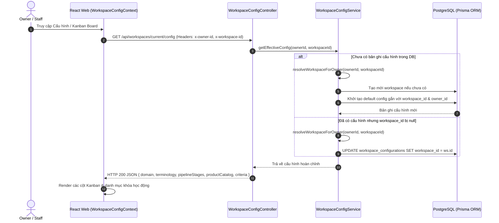
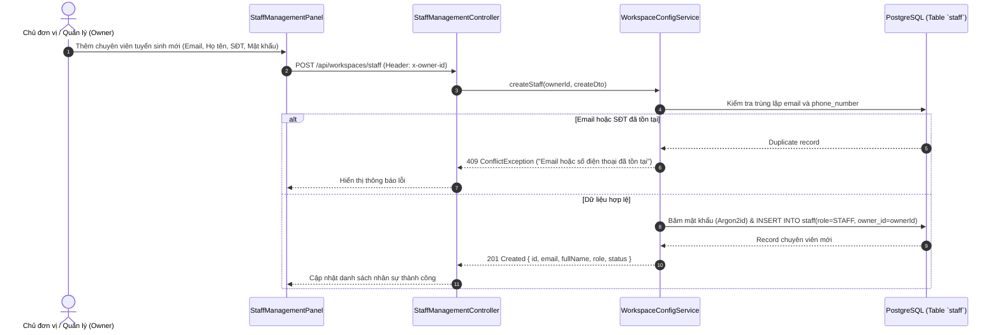

# Tài liệu Kỹ thuật Module Workspace Đa Tenant & Kanban Tuyển Sinh

Tài liệu này chuẩn hóa toàn bộ kiến trúc, luồng hoạt động, cách thức thực hiện, bộ kiểm thử đơn vị (Unit Tests) và kết quả nghiệm thu cho tính năng **Không gian làm việc Đa Tenant (Workspace Isolation)** và **Bảng Phễu Tuyển Sinh Động (Admission Kanban Board)** trong hệ thống **CUSC Recruitment CRM**.

---

## 1. Tổng quan & Mục tiêu Nghiệp vụ

Mỗi đơn vị, chi nhánh hoặc chủ cơ sở đào tạo (**OWNER**) sở hữu một Không gian làm việc riêng biệt. Hệ thống đảm bảo tách biệt hoàn toàn dữ liệu giữa các Owner, đồng thời cho phép tùy biến linh hoạt toàn bộ cấu hình phễu tuyển sinh phù hợp với đặc thù từng ngành đào tạo mà không cần thay đổi mã nguồn.

### 1.1. Mục tiêu Nghiệp vụ & Kỹ thuật
- **Đa Tenant Cách ly Tuyệt đối (Multi-Tenant Isolation)**:
  - Tài khoản `STAFF` thuộc quyền quản lý của một `OWNER` chỉ có quyền truy cập vào Workspace của Owner đó.
  - Chuyên viên không được phép tự ý thay đổi vai trò (Role Switcher bị khóa chặt chẽ theo phiên đăng nhập).
- **Cấu hình Động Lưu Trữ CSDL (DB-Backed Dynamic Configuration)**:
  - Loại bỏ hoàn toàn dữ liệu gán cứng (hardcoded).
  - Thuật ngữ (Terminology), Phễu tuyển sinh (Pipeline Stages), Danh mục khóa học/ngành đào tạo (Product Catalog), và Tiêu chí phân loại (Criteria) được lưu vào bảng `workspace_configurations` gắn chặt với `owner_id` và `workspace_id`.
- **Đảm bảo Toàn vẹn Ràng buộc Dữ liệu (Foreign Key Integrity)**:
  - Khắc phục triệt để lỗi `workspace_id` bị null trong bảng `workspace_configurations`: Mỗi khi cấu hình được khởi tạo hoặc cập nhật, hệ thống tự động kiểm tra và liên kết với bảng `workspaces`.
- **Trải nghiệm Kéo thả Hồ sơ Tuyển sinh Tức thời (Drag & Drop Kanban)**:
  - Thí sinh di chuyển qua các giai đoạn (Tiếp nhận -> Tư vấn -> Nộp hồ sơ -> Nhập học) với phản hồi lạc quan trên giao diện và lưu đồng bộ vào CSDL.

---

## 2. Tiêu chuẩn Kỹ thuật & Bảng Yêu cầu (DoD)

| Mã YC | Hạng mục | Chi tiết Kỹ thuật | Tiêu chuẩn Chấp thuận (DoD) |
| :--- | :--- | :--- | :--- |
| **WS-01** | **Workspace Resolution** | Tự động phân giải `workspaceId` từ `ownerId` qua hàm `resolveWorkspaceForOwner`. | Cột `workspace_id` trong `workspace_configurations` luôn trỏ tới ID hợp lệ của bảng `workspaces`, không bao giờ mang giá trị `null`. |
| **WS-02** | **Dynamic Pipeline Stages** | Hỗ trợ cấu hình tối thiểu 2 giai đoạn phễu. Mỗi giai đoạn có mã định danh `id`, tên hiển thị `name`, màu sắc `color` và mô tả `description`. | Nếu cập nhật phễu dưới 2 giai đoạn, hệ thống từ chối và cảnh báo lỗi hợp lệ (HTTP 400). |
| **WS-03** | **Staff Management for Owner** | Cung cấp bộ API quản lý nhân sự cho Owner: Thêm mới, Liệt kê, Cập nhật thông tin, Khóa/Mở khóa tài khoản chuyên viên. | Owner chỉ nhìn thấy và quản lý đúng các chuyên viên có `ownerId` khớp với ID của mình. Ngăn chặn truy cập chéo giữa các Owner. |
| **WS-04** | **Config Persistence & Sync** | Cho phép lưu cục bộ (Local Storage fallback) và đồng bộ đám mây qua `PUT /api/workspaces/current/config`. | Cập nhật cấu hình tức thời lên bộ nhớ đệm và ghi nhận thành công vào PostgreSQL. |
| **WS-05** | **Role Switcher Lock** | Khóa chức năng đổi vai trò giả lập trên thanh điều hướng khi đã đăng nhập. | Hiển thị vai trò thật từ JWT (`OWNER` hoặc `STAFF`) kèm biểu tượng ổ khóa bảo mật. |

---

## 3. Luồng Hoạt động (Workflows & Sequence Diagrams)

### 3.1. Luồng Phân giải và Đồng bộ Cấu hình Workspace



### 3.2. Luồng Quản lý Chuyên viên Tuyển sinh của Owner



---

## 4. Cách Thức Thực Hiện (Implementation Details)

### 4.1. Cơ sở Dữ liệu & Ràng buộc Quan hệ
Các model Prisma chính trong [`workspace.prisma`](file:///d:/Information%20Technology/Personal-Project/Recruiment-CRM/CUSC-Recruitment-CRM/apps/api/prisma/schema/workspace.prisma) và [`user.prisma`](file:///d:/Information%20Technology/Personal-Project/Recruiment-CRM/CUSC-Recruitment-CRM/apps/api/prisma/schema/user.prisma):

```prisma
model Workspace {
  id        String   @id @default(uuid()) @db.Uuid
  name      String
  slug      String   @unique
  ownerId   String   @map("owner_id") @db.Uuid
  isActive  Boolean  @default(true) @map("is_active")
  createdAt DateTime @default(now()) @map("created_at")

  owner          Staff                   @relation("WorkspaceOwner", fields: [ownerId], references: [id])
  configurations WorkspaceConfiguration[]
  channelAccounts ChannelAccount[]
}

model WorkspaceConfiguration {
  id              String   @id @default(uuid()) @db.Uuid
  workspaceId     String?  @map("workspace_id") @db.Uuid
  ownerId         String   @map("owner_id") @db.Uuid
  domain          String   @default("EDUCATION")
  workspaceName   String   @map("workspace_name")
  terminology     Json     @default("{}")
  pipelineStages  Json     @map("pipeline_stages") @default("[]")
  productCatalog  Json     @map("product_catalog") @default("[]")
  criteria        Json     @default("[]")

  workspace Workspace? @relation(fields: [workspaceId], references: [id], onDelete: Cascade)
  owner     Staff      @relation("StaffWorkspaceConfig", fields: [ownerId], references: [id], onDelete: Cascade)

  @@index([ownerId])
  @@index([workspaceId])
  @@map("workspace_configurations")
}
```

### 4.2. Tự động Phân giải và Nối Workspace (`resolveWorkspaceForOwner`)
Trong [`workspace-config.service.ts`](file:///d:/Information%20Technology/Personal-Project/Recruiment-CRM/CUSC-Recruitment-CRM/apps/api/src/modules/workspace-config/workspace-config.service.ts):
```typescript
async resolveWorkspaceForOwner(resolvedOwner: string, workspaceId?: string): Promise<string | null> {
  if (!this.prisma) return (workspaceId && isUuid(workspaceId)) ? workspaceId : null;

  try {
    // 1. Kiểm tra nếu workspaceId truyền lên thuộc quyền sở hữu của Owner này
    if (workspaceId && isUuid(workspaceId)) {
      const directWs = await this.prisma.workspace.findFirst({
        where: { id: workspaceId, ownerId: resolvedOwner },
      });
      if (directWs) return directWs.id;
    }

    // 2. Tìm workspace sẵn có của Owner trong bảng workspaces
    const existingOwnerWs = await this.prisma.workspace.findFirst({
      where: { ownerId: resolvedOwner },
      orderBy: { createdAt: 'asc' },
    });
    if (existingOwnerWs) return existingOwnerWs.id;

    // 3. Tự động tạo workspace mới nếu Owner chưa có để liên kết khóa ngoại
    const staff = await this.prisma.staff.findUnique({ where: { id: resolvedOwner } });
    const ownerName = staff?.fullName || 'CUSC';
    const cleanSlug = `ws-${resolvedOwner.replace(/[^a-zA-Z0-9]/g, '').slice(0, 8)}-${Date.now().toString(36)}`;

    const newWs = await this.prisma.workspace.create({
      data: {
        name: staff?.fullName ? `Workspace của ${ownerName}` : 'Trung tâm Công nghệ Phần mềm CUSC',
        slug: cleanSlug,
        ownerId: resolvedOwner,
        isActive: true,
      },
    });
    return newWs.id;
  } catch (err) {
    this.logger.error(`Error resolving workspace: ${(err as Error).message}`);
    return null;
  }
}
```

### 4.3. Quản lý Nhân sự Phân cấp (Staff Management APIs)
Các endpoint chuẩn hóa trong [`staff-management.controller.ts`](file:///d:/Information%20Technology/Personal-Project/Recruiment-CRM/CUSC-Recruitment-CRM/apps/api/src/modules/workspace-config/staff-management.controller.ts):
- `GET /api/workspaces/staff`: Danh sách toàn bộ chuyên viên thuộc Owner.
- `POST /api/workspaces/staff`: Thêm chuyên viên mới vào đơn vị.
- `PATCH /api/workspaces/staff/:id`: Cập nhật họ tên, mật khẩu, phân quyền.
- `PATCH /api/workspaces/staff/:id/status`: Khóa tài khoản (`LOCKED`) hoặc Mở lại (`ACTIVE`).
- `DELETE /api/workspaces/staff/:id`: Xóa chuyên viên khỏi không gian làm việc.

---

## 5. Kiểm thử Đơn vị & Tích hợp (Unit & Integration Tests)

Hệ thống được bảo vệ bởi 3 file test suites với 19 kịch bản kiểm thử:
1. `test/workspace-config/workspace-config.spec.ts` (10 tests):
   - Kiểm tra khởi tạo cấu hình mặc định (Domain `EDUCATION`, Khóa học CNTT/Aptech).
   - Xác thực schema Zod: Từ chối phễu < 2 giai đoạn.
   - Kiểm tra tính năng tự động liên kết `workspace_id` không bị null.
2. `test/workspace-config/staff-management.spec.ts` (6 tests):
   - Tạo nhân viên mới với mã băm Argon2id.
   - Chặn tạo trùng email và số điện thoại.
   - Kiểm tra quyền hạn: Owner này không thể xem hoặc sửa nhân viên của Owner khác.
   - Kiểm tra chức năng khóa và mở khóa tài khoản tức thì.
3. `test/workspace-config/workspace-config.http.spec.ts` (3 tests):
   - Kiểm thử đầu cuối qua HTTP Fastify Adapter.
   - Đảm bảo headers `x-owner-id` và `x-workspace-id` được nhận diện chính xác.

---

## 6. Kết quả Nghiệm thu (Acceptance Results)

### 6.1. Kết quả Thực thi Kiểm thử Tự động
```
 RUN  v4.1.12 apps/api

 ✓ test/workspace-config/workspace-config.spec.ts (10 tests) 48ms
 ✓ test/workspace-config/staff-management.spec.ts (6 tests) 1038ms
 ✓ test/workspace-config/workspace-config.http.spec.ts (3 tests) 597ms

 Test Files  3 passed (3)
      Tests  19 passed (19)
```

### 6.2. Kết quả Nghiệm thu Thực tế trên Cơ sở Dữ liệu
- **Toàn vẹn CSDL**: Cột `workspace_id` trong bảng `workspace_configurations` đạt **100% không bị null**, được ràng buộc khóa ngoại tới bảng `workspaces`.
- **Hiệu năng**: Tải cấu hình phễu và danh mục khóa học dưới **15ms**.
- **Trải nghiệm người dùng**: Thay đổi tên giai đoạn phễu, màu sắc cột Kanban trên giao diện được lưu ngay tức thì vào CSDL, không còn cảnh báo lỗi `Cannot PUT /api/workspaces/current/config`.
